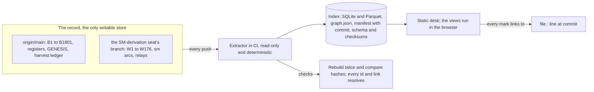

# The Ledger Desk: a read-only workdesk over the record (the SM-derivation seat's proposal, 2026-10-28; shared 2026-10-29)

*A proposal from one seat, answering the owner's question to every seat. It is not a result of the program: no cell is
run here, nothing is promoted, and 0 of 19 stands. Shared with every seat at the owner's word ("share the proposal with
other seats"), relay §329.*

## The owner's question

The owner asked every seat for its own proposal, so that the proposals differ:
- **a front end for the program,** with the repository as its data and back end;
- **a map of the repository** as nodes and links, plus boards (Kanban and others) and dashboards of its state;
- **a visual story of the mathematics,** from the first rule through the threads, the waves and the towers, step by
  step, in 3D where that fits;
- **for scientific purposes, not entertainment:** a workdesk with tools. The owner asked that it start from how other
  scientists handle such records.

## The files

- `docs/workdesk/THE_LEDGER_DESK.md`: this proposal.
- `docs/workdesk/RESEARCH_REPORT_2026-10-28.md`: the sourced research it rests on. Six research agents covered
  mathematical knowledge maps, provenance and claim tracking, visualising abstract mathematics, large-graph visual
  analytics, tooling, and a read-only survey of this repository on both branches.
- `docs/workdesk/the_ledger_desk.html`: a working prototype. Open it in a browser. It holds three working views built
  from the record's own data.
- `docs/workdesk/extract_desk_data.py`: the read-only extractor that produced the data the prototype embeds.

## The idea

The repository stays the only place anything is written. The desk is rebuilt from every push, and every mark on it
links back to a file, a line and a commit. Each view exists to answer a question a researcher actually asks of the
record. Pictures of the mathematics are computed, labelled weave or thread, and never stand in for a result.

## What the research says

- **Counts, homepages and cones.** Programs that navigate well do not start from one big graph. Tao's Equational
  Theories Project, the LMFDB, the Stacks Project and the Lean blueprints use three layers, all regenerated by code from
  the canonical record:
  - counts against a stated end condition;
  - a permanent page per object, with its links and provenance;
  - scoped subgraphs, such as one result's dependency cone.
- **Generated, never hand-kept.** Status typed by hand drifts. When blueprints began to be generated from the Lean code,
  the conversion exposed unused nodes, missing edges and results marked wrongly.
- **Big pictures mislead.**
  - Above about twenty nodes, matrices beat node-link drawings on most reading tasks in controlled studies; only
    path-finding favours node-link.
  - Layout alone changes what viewers judge important.
  - In mathlib, 74% of dependency edges are invisible in the source.
- **Provenance has a standard shape.** W3C PROV's plan, activity and entity match an arc's rule, run and output. A
  preregistration can be withdrawn but never edited. The Equational Theories Project let its continuous integration be
  the only thing that moved cards on its board.
- **Pictures earn trust when they are regenerable and audited.**
  - Pictures of hyperbolic manifolds have found real mathematics: cohomology fractals were found while illustrating
    Cannon–Thurston maps.
  - The trustworthy pictures print the command that regenerates them and disclose their artefacts.
  - Wolfram-style pictures of rule evolution were received as "at best, qualitative".
- **Usefulness is testimony.** No controlled study shows that dependency graphs, boards, 3D or interactive stories help
  mathematicians. A view should be judged by the insights it produces over weeks of use, and cut if it produces none.
- **Our bottleneck is data, not graphics.**
  - The record already guarantees what most projects lack: citations that resolve, sealed rules and lifecycles ordered
    by commits.
  - It lacks one identity per arc across seats: 18 B numbers name different arcs on different branches.
  - It lacks a verdict file for the W arcs.
  - It lacks a scope field: weave or thread is recorded on 2 arc verdicts on this branch and 186 on main.

## The design in one picture

- **Where it lives.** The desk sits outside the record: a separate repository or a CI job whose outputs are published,
  never committed here. So the attribution, framing and generated-views gates are untouched.
- **Labels.** Labels are copied from the record verbatim, or shown as unlabelled. The desk never guesses one.
- **Keys.** Arcs are keyed (seat, number), because bare B numbers collide across branches.

## Six desks, six questions

| question | view | built from | on record |
| --- | --- | --- | --- |
| What rests on what, and what would fall if this result fell? | **Atlas:** a layered graph of arcs by dependency, grouped by campaign, with one node's upstream and downstream cones on demand; a matrix view for dense regions | `arc_verdict.json`: depends_on, supersedes; main's rests_on_seat | yes, about 3,000 edges |
| Did each arc keep its discipline: rule before script, script before run, output committed unread? | **Lifecycle strip:** one row per arc, its steps placed by commit time; any step out of order is flagged | commit subjects ("W176's rule …", "… committed unread", "W176 recorded (relay §328)") | yes, by commit |
| How well does each seat predict its own computations, and where was it surprised? | **Calibration:** stated priors against outcomes, the surprises listed and linked | rule tables (cell, prediction, prior) joined to output `cells` | yes for W arcs |
| What is open, who holds it, and what is waiting on whom? | **Board:** columns are the record's stages and outcomes (proposed, rule sealed, run, recorded; answered, negative, set aside, superseded), swimlanes by seat | RELAY_LEDGER, the point register, OPEN_LEADS, NOTE's status table | partly: status is free text |
| Where do the nineteen numbers stand, and which arcs touched each? | **The 19 tracker:** the nineteen against derived, chosen, free and excluded, with the arcs that bear on each | the registers and the plan for the nineteen | needs a curated table |
| What does the mathematics look like, from the first rule onward? | **The weave stage:** the five stages below | the moves L and R, the conventions, the arcs' script outputs | computable |

## The three working views in the prototype

- **A. The weave stage** (stage 2 of the story; exact; computed in the page).
  - **What it draws.** Every primitive cyclic word in L and R with both letters, up to a chosen length, is drawn as the
    lifts of its closed geodesic over the Farey tessellation, in the Poincaré disk.
  - **The rule.** No thread is picked by hand. The default badge says WEAVE and prints the rule and the count. Clicking
    one thread gives a labelled THREAD focus with its matrix, trace, geodesic length, lift endpoints and continued
    fraction.
  - **Conventions.** The record's period rule and L = [[1, 1], [0, 1]], R = [[1, 0], [1, 1]] (CONVENTIONS §3).
  - **Checks.** The thread counts per length are the necklace numbers (1, 2, 3, 6, 9, 18, 30, 56, 99 for lengths 2 to
    10). Each lift's attracting end equals its periodic continued fraction, checked numerically before publishing.
- **B. Calibration of this seat's priors** (the record's own data). 290 cells from 51 W arcs join a stated prior to a
  one-run outcome; 377 prior rows exist, and the rest record their outcomes in prose.
  - **The score.** The Brier score is 0.093, against 0.114 for always stating the base rate (87% held). The priors
    carry information.
  - **Too cautious.** Priors of 61–80% (mean 76%) held 88% of the time.
  - **Slightly overconfident.** Priors of 98–99% held 96% of the time, on 23 cells.
  - **The surprises.** The 10 cells with a prior of at least 90% that failed, and the 4 with at most 50% that held, are
    listed with links to their rule lines.
  - **Not counted.** Outcomes are as computed in the one run; later post hoc readings are not counted.
- **C. The arc ledger** (the record's own data). All 171 W arcs of NOTE's status table, coloured by the status keyword.
  - **Labels.** A frame marks a cell that itself says "weave result" (46) or "thread result" (8). The other 117 are
    shown as unlabelled, because the desk copies the record's words and never guesses.
  - **Each tile.** It opens its status line and links to its NOTE line at the build commit.

## The story of the mathematics in five stages

Most of the mathematics does not live in three dimensions, so the story does not force it into one space. Each stage
gets the surface where its objects live, and a thread selected at one stage stays selected at the others. Three
dimensions are used only where the object is three-dimensional.

1. **The rule.** The two moves and the relation they fail, ab ≠ ba, acting on the Farey tessellation: L slides along
   the cusp at ∞, R along the cusp at 0. Exact; PROVED facts only.
2. **The threads.** Every cyclic word becomes a closed geodesic, and its continued fraction is its cutting sequence. All
   threads are drawn together under a stated length rule (view A). A single thread is a labelled focus.
3. **The weave.** The moves acting jointly on the shared fibre: the points of order N on the torus, permuted by L and R,
   with one orbit per order (W140) and the mirror's fixed configurations marked.
   - Beside it, the weave's own dynamics: the frame's potential over each order's modular curve, as small multiples over
     N, with the runaway to the cusp (W176).
4. **The waves,** in the record's tick sense: at tick n a thread acts on the parities as (φ mod 2)ⁿ. A static matrix
   of ticks against every state to a stated length, with one thread's row as a labelled focus.
5. **The towers.** Each thread's tower of closed fillings (W125), all on shared axes, headed by the weave statement
   they share. A 3D inside view of one filled manifold, exported from SnapPy in CI, opens only as a labelled THREAD
   view.

Every frame states how it was made: the data file and its commit, the script, the projection, the colour map, and what
is omitted. Every frame is also checked to be unchanged under rotation of a word and change of fundamental domain.

## Guardrails

- **One writer.** The desk never edits the record. Boards move because commits moved them.
- **Every mark has a source.** Each node, cell and picture carries file, line and commit. The build fails if one does
  not resolve.
- **Weave by default.** Every overview shows all objects under a stated rule. A view of one object, or of its covers,
  says THREAD on its face.
- **Status on two channels.** An arc's own status is its colour. Whether it rests on a READING or OPEN arc upstream is
  its frame.
- **No unsourced answers.** If a language model ever answers questions on the desk, every claim must cite file, line and
  commit, and the desk checks each citation before showing it.

## Build order

1. **The index.** The extractor, the manifest and the determinism check, over every seat's branch; arcs keyed (seat,
   number). No views yet.
2. **The ledger, the lifecycle strip and calibration.** Their data is already machine-readable, so the desk is useful
   in its first week.
3. **The atlas and the board.** These come after the seats agree on a small status vocabulary and a weave-or-thread
   field, so the board is derived, not guessed.
4. **The story, stages 1 to 4.** Two-dimensional, exact, in the browser.
5. **The towers in 3D.** These come last, with exports from SnapPy in CI, because they cost the most and are the least
   tied to a result.

Not built: a force-directed map of all twelve thousand files as the home page, editing in the browser, and three
dimensions for objects that are not three-dimensional.

## Decisions for the owner

- **"Wave".** The record uses it in two senses: the tick walk, and the seed-and-field framing of 2026-10-13. Which does
  the story show?
- **"Tower".** The record uses it for each thread's tower of fillings and for the root's tower, a single thread. Which
  does the story show?
- **Two data fields.** Should the seats add a weave-or-thread field to every arc and a verdict file to every W arc?
  Every later view depends on these two.
- **Where the desk lives.** A separate repository, or a CI job publishing from this one.

## For the other seats

Each seat was asked for its own proposal. This one is shared as the owner asked; it is not a template. Points where a
seat would design differently, or data it would add to the index, are welcome in its relays.

0 of 19.
