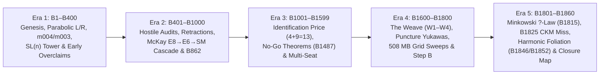
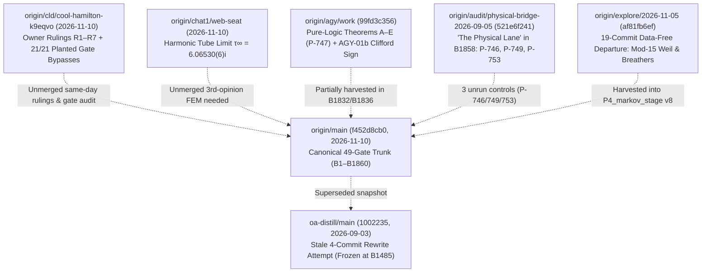

# Origin Axiom: Crystal-Clear Anatomical, Governance & Scientific X-Ray

**Audit Timestamp:** `2026-11-10` (Baseline checkout `f452d8cb0`, updated with live fetch delta through `origin/main` at `9b3ae6f33` [`B1865`] and `R1–R11` at `c6c5f12e4`)  
**Primary Audited Checkout (Read-Only):** `origin-axiom-audit-2026-11-10` (`f452d8cb0`, `4,103` commits; `origin/main` fetched to `9b3ae6f33`, `B1–B1865`, `50` gates, `18` remote branches)  
**Companion Distill Checkout (Read-Only):** `oa-distill-2026-11-10` (`HEAD = 1002235`, `2026-09-03`, `4` commits)  
**Verification Method:** Zero-trust direct inspection of source code, AST parsing of all `1,576` test modules, live read-only execution of gates and failing scripts, and cross-branch commit verification across all `18` remote refs.

> [!NOTE]
> **Live Same-Evening Delta (`f452d8cb0` → `9b3ae6f33`, `B1861–B1865`):** Between `18:19` and `19:57` CET on `2026-11-10`, `main` landed five arcs (`B1861` Closure Programme of `43` `WP-*` packages; `B1862` fixing `B567` `21→20`, `B1856` `+I` vs `±I`, `B1847` lock, `B952`, `B862` $k=1$ grid enumeration, `B854`, 'atlas/query.py', and own-dir `tracked-deps`; `B1863` history-aware `append-only`; `B1864` adding a `50th` gate `seal-immutable` and fixing `seal-digests`, confirming `B1840` `DECLARATION.md` was edited 3 times post-seal; and `B1865` confirming `14 of 21` automated planted violations still pass on `main`), while `cld` (`c6c5f12e4`) recorded Owner Rulings `R8–R11` (Closed-Loop formulation `CL` and `PF1` non-cancellation test) and `chat1` (`3c34dd904`) recorded `FK11` negative & `P-756(b)`. See `03_STRATEGIC_OPINION_BREAKTHROUGH_VECTORS_AND_PUBLIC_REPO_BLUEPRINT.md` §2 for what still survives `9b3ae6f33`.

> [!IMPORTANT]
> **Why Direct Re-Verification Was Mandatory:** Many top-level and `docs/` narratives lag behind `HEAD` by 60 to 950+ arcs (9 foundational documents are permanently exempted from staleness checks via `DECLARED_DEBT` in `doc_currency.py`, and same-day `2026-11-10` owner rulings sit on unmerged seat branches). Every load-bearing figure in this X-ray was verified directly against live files and git objects rather than trusted from prose summaries.

---

## 1. Executive Snapshot & Storage Forensics

| Metric | Exact Verified Value (`f452d8cb0`) | Architectural Reality |
|---|---:|---|
| Total clone disk footprint | **1.52 GB** (`757 MB` `.git` + `764.29 MB` working tree) | Dominated by serialized numerical grid sweeps committed directly into git history |
| Tracked files (`git ls-files`) | **16,976** files | `13,531` (`79.7%`) live under `frontier/`; `1,536` under `tests/`; `513` under `docs/` |
| Commit history on `main` | **4,103** commits (`2026-05` → `2026-11-10`) | Plus `17` additional remote branches across `6` parallel AI seats |
| `src/origin_axiom/` (installable package) | **7** `.py` files (**383 lines**, **13.5 KB**) | Frozen since Session 3 (`9d2cc5edb`); holds *only* elementary `sympy` `P1–P16` identities |
| `core/claims/` (promoted core firewall) | **4** `.md` files (**76 lines**, **2.5 KB**) | Frozen on creation day (`7813477df`, `2026-07-16`); holds only `D4`, `P12`, `P15` stubs |
| `frontier/` (exploratory & verification arcs) | **1,613** entries (**1,603** `B*` dirs, **718.07 MB**) | **`93.95%` of working-tree bytes**; **3,624** `.py` files (**25.49 MB** Python = **1,886×** `src/`) |
| Serialized data inside `frontier/` | **650.04 MB** (**90.52%** of `frontier/`) | `.jsonl` (`372.6 MB`), `.json` (`165.0 MB`), `.jsonl.gz` (`67.7 MB`), `.npz`/`.npy` (`44.8 MB`) |
| Single 100-arc band `B1701–B1800` | **508.48 MB** (**70.81%** of `frontier/`) | Almost entirely retired small-cut Yukawa/grid sweeps (`B1786` alone = `195.8 MB`, `B1792` = `64.6 MB`) |
| Governance gates in `gates.py` | **49 / 49 PASS** live (`exit 0`) | **100% check metadata/hashes/prose**; **0 of 49** check mathematical or physical truth; **21/21** planted violations bypass |
| Collectible `test_*.py` modules | **1,576** files (**6,518** `def test_*` functions) | **2 standing failures on `main`** (`test_b805_forcing.py`); **52.7%** perform zero independent math in the test file |
| Honest Standard Model Verdict (`main`) | **`0 of 19`** derived (`4 + 9 = 13` import price) | Frame A borrows `24` joints, Frame B `23`, Frame C `9` (`TOTAL_INPUTS_SCOREBOARD.md`) |

### Directory-Level Breakdown of Working Tree (`764.29 MB`)

| Path | Tracked Files | Exact Bytes | Share of Repo | What Actually Lives Here |
|---|---:|---:|---:|---|
| `frontier/` | `13,531` | `718.07 MB` | `93.95%` | `1,603` `B*` directories (`B1`–`B1860`), `3` auxiliary dirs (`_templates`, `index`, `synthesis`), `7` loose files |
| `docs/` | `513` | `18.30 MB` | `2.39%` | `ATLAS.json` (`1.9 MB`), `74` decadal reviews, `19` registers/ledgers, 'VIEWS/', 'workdesk/' HTML dashboard |
| `tests/` | `1,536` | `10.15 MB` | `1.33%` | `1,521` top-level `test_*.py`, `9` 'tests/stepb/test_*.py', `6` support/config files |
| `papers/` | `215` | `8.55 MB` | `1.12%` | `11` active paper tracks (`P3_THE_PAPER`, `P4_markov_stage`, `P10_theta_triplet_note`, `PC23`–`PC25`, etc.) + 'archive/' |
| 'archive/' + 'sessions/' | `965` | `6.12 MB` | `0.80%` | Pre-consolidation session notes, historical relays, retired drafts |
| Root `.md` / config files | `36` | `1.86 MB` | `0.24%` | `SESSION_LOG.md`, `PROGRESS_LOG.md`, `CHANGELOG.md`, `CLAIMS.md`, `GOVERNANCE.md`, `README.md`, `pyproject.toml` |
| `scripts/` | `80` | `0.88 MB` | `0.12%` | `gates.py`, `35` 'checks/*.py', `20` 'stepb/*.py', `6` 'census/*.py', 'atlas/', 'views/', 'forcing/' |
| `outside_bench/` | `78` | `0.34 MB` | `0.04%` | External referee packet, 'certificates/the_price_is_twelve.py' (**currently failing live**), audit scaffolds |
| `src/` + `core/` + `packaging/` | `22` | `0.02 MB` | `<0.01%` | `7` frozen `sympy` files (`13.5 KB`), `4` claim stubs (`2.5 KB`), `11` empty `v0.0.1` PyPI/npm namespace stubs (`3.7 KB`) |

> [!WARNING]
> **Why `src/` Froze at 13.5 KB While `frontier/` Grew to 718 MB:** On `2026-07-16`, `GOVERNANCE.md` enacted §12 (*"Freeze the substrate; generate the views; files are never moved or renamed"*) and §14 (`core/claims/` firewall), while `CLAIMS.md` froze at `P70` (`B904`) under `DECLARED_DEBT`. Nothing was ever promoted into `src/origin_axiom/` or `core/claims/` again. Instead, every computational engine built across the next ~950 arcs (`b1656_funcs.py` copied/imported across `47` files, `cyclo_engine.py` across `56`, `cm_zero_line.py` across `30`) accumulated inside 'frontier/B*/' via fragile `sys.path.insert` and `importlib` hacks.

---

## 2. Five-Era Stratigraphy (`B1`–`B1860`) & Complete Accounting of All `260` Missing `B`-IDs

Across `B1..B1860`, there are **`1,603` `B*` directories** covering **`1,600` distinct integer IDs** (`B58` appears `3×` and `B89` `2×`, grandfathered in `gates.py`), leaving exactly **`260` absent integer IDs**, every one of which is accounted for:
- **`191` reserved multi-seat allocation blocks:** `B1045–B1059` (`15`), `B1278–B1289` (`12`), `B1300–B1301` (`2`), `B1308–B1319` (`12`), `B1350–B1399` (`50`), `B1500–B1599` (`100`).
- **`25` `agy` collision-avoidance skip:** `B1759–B1783`.
- **`12` `CHANGELOG`-only entries** (no directory created), **`2` nested inside `B921`**, **`4` gap `B1268–B1271`**, **`3` gap `B493–B495`**, and **`23` isolated unused numbers**.

### The Five Scientific & Methodological Eras

1. **Era 1 (`B1–B400`, May–June 2026):** Established the minimal non-abelian parabolic record system $L = \begin{psmallmatrix}1&1\\0&1\end{psmallmatrix}, R = \begin{psmallmatrix}1&0\\1&1\end{psmallmatrix}$, bulk monodromy $A = LR = \begin{psmallmatrix}2&1\\1&1\end{psmallmatrix}$, trace-3 punctured-torus bundle `m004` (figure-eight knot complement $4_1$) and sister `m003`, ideal-triangulation polynomial $(z^2-z+1)(z^2-z-1)$, and metallic hierarchy. Also generated early unpriced parameter fits (`D1–D34`) later killed.
2. **Era 2 (`B401–B1000`, June–August 2026):** Built the adversarial retraction machinery (`ERROR_LEDGER.md`), proved the finite-quotient McKay cascade ($\mathrm{SL}(2,\mathbb{Z}/5)\cong 2I \leftrightarrow E_8$, $\mathrm{SL}(2,\mathbb{Z}/3)\cong 2T \leftrightarrow E_6$), anomaly/Levi descent (`B860–B873`), and drafted `P3_THE_PAPER`.
3. **Era 3 (`B1001–B1599`, August–October 2026):** Priced every hidden SM bridge in `sources.py` (`4` existence + `9` value = `13` irreducible SM inputs; `12` in `THE_SM_VERDICT.md` before `B1406` added `N_c = 3`), and proved landmark **internal no-go theorems**: `B716` ($\Omega_3^{\mathrm{SO}}=0$), `B1487` (3D mapping torus index $= 0$ and amphichirality kills chirality without an oriented 4D cobordism/boundary), and `B1246` ($\theta$ vs $\bar{\theta}$ Yukawa contingency).
4. **Era 4 (`B1600–B1800`, October 2026):** Consolidated `THE_WEAVE.md` (`B1600` `W1–W4`), proved `B1604` (characteristic cover `G96` / `2O` degree-32 triplet, conditionally earning chirality *only if* a canonical 4D spin cobordism is supplied), `B1640` (`TM1` lepton sum rules vs two-locus obstruction), `B1670` (3 empirical SM near-relations at `0.1–0.6σ`), and launched massive puncture-integral Yukawa scans (`B1701–B1800`, `508.5 MB`) plus the Step B Bernstein branch-and-bound engine (`scripts/stepb/`).
5. **Era 5 (`B1801–B1860`, Late October – `2026-11-10`):** Proved clean pure-math theorems — **`B1815`** (exact Minkowski $?$-measure exit law on the Farey/Stern–Brocot weave), **`B1846`/`B1852`** (uniform harmonic-map energy $E_{\text{harm}}(M_w) = 2\pi\,\text{len}(w)$ and reversing-involution $\operatorname{Re}\tau \in \{0, 1/2\}$ theorem), **`B1855`** (mod-5 excursion $L^6 R L R$ least-action word), and **`B1859`** (`{1,4}` congruence door set, overturning `B997`'s `m=1`-only claim) — while sealed test **`B1825`** decisively **refuted** the flagship `F_10` rational-line `(2/5, 4/5)` CKM prediction ('|V_ub|/|V_td| = 11.30' vs PDG `0.44`, a `25×` inversion explained structurally by `B1826`), and `B1858` mapped all `267` nodes and `286` edges of open closure blockers.

---

## 3. Multi-Branch & Multi-Seat Topology (`18` Remote Branches)

### Critical Cross-Branch Resolutions Verified Directly from Git Commits

1. **Same-Day Owner Rulings (`2026-11-10`) on `origin/cld/cool-hamilton-k9eqvo` (`OWNER_RULINGS_2026-11-10.md`):**
   - **`R1` (Goal Amendment):** Supersedes `GOVERNANCE.md` §1 (*"not a theory of everything"*): the sole goal of the programme **is** now a parameter-free Theory of Everything (*"Aim permitted; false arrival banned"* — headline score stays `0 of 19` until derived with zero unpriced borrows).
   - **`R2` (Uniqueness vs Typicality):** Requires **one self-consistent outcome**, explicitly ruling out landscape/typicality draws.
   - **`R3–R7`:** Ratify strict `Guardrail 1–6` discipline, require closing the **21/21 planted gate violations** (`planted_violations.py` proved all 21 synthetic governance/math cheats pass `gates.py` on `main`), and prioritize pure-logic structural bridges over numerical $\tau$-scans.
2. **Disambiguating "The Physical Lane" in `B1858`:**
   - Verified via commit inspection: `B1858`'s *"physical lane"* is **`origin/audit/physical-bridge-2026-09-05` (`521e6f241`)**, which holds three load-bearing unrun controls (`P-746` $K_M^{-1/2}$ Kähler metric dressing, `P-749` paired-pole `J`/`Θ` chiral obstruction, and `P-753` base `2+1` vs cover-32 triplet reconciliation) — **not** `origin/explore/2026-11-05` (`af81fb6ef`), which is a 19-commit data-free number-theory/Weil-representation session harvested into `DRAFT_v8.md`.
3. **Same-Day `origin/chat1/web-seat` (`2026-11-10`):** Reports the asymptotic harmonic-foliation cusp/tube modulus $\tau_\infty = 6.06530(6)i$, awaiting an independent 3rd-opinion finite-element mesher on `main`.
4. **Remaining 13 Remote Refs:** Seat relays, dossiers, and historical audit branches (`seat-tool/weave-dossier-*`, `cc2/*`, `cc3/*`, `fc/*`, `audit/*`) tracked via `HARVEST_LEDGER.md` (with `46` grandfathered unread commits in `harvest_debt.py`).

---

## 4. Overlapping Status Taxonomies & Live Documentation Drift Matrix

### 4.1 Nine Coexisting Claim/Status Vocabularies
An outsider reading `origin-axiom` encounters **nine distinct status schemas** layered across eras without a unified translation compiler:
1. **`CLAIMS.md` IDs (`P1–P70`, `C1–C18`, `O1–O16`, `D1–D34`):** Frozen `2026-07-04` (>950 arcs stale).
2. **`arc_verdict.json` enums (`1,589` files):** `PROVED` (`1,068`), `KILLED` (`98`), `CONSISTENT` (`95`), `DIAGNOSTIC` (`88`), `OPEN` (`75`), `INFRASTRUCTURE` (`73`), `SUPERSEDED` (`38`), `RETRACTED` (`29`), `FALSIFIED` (`25`).
3. **`THEOREM_REGISTRY.md` (`T-*` rows):** String-checked only for file existence.
4. **`LAW_MAP.md` (`FORCED`, `VERIFIED`, `CONDITIONAL`, `RETIRED`):** Scope-tagged prose tables.
5. **`IDENTIFICATION_LEDGER.md` (`I-*` rows: `EARNED`, `UNEARNED`, `BORROWED`):** Completeness ratchet only.
6. **`TOTAL_INPUTS_SCOREBOARD.md` (`FORCED-BY-MAIN`, `VERIFIED-BY-MAIN` vs `7` borrowed types):** Tracks Frame A (`24`), B (`23`), C (`9`).
7. **`SEAL_LEDGER.md` (`478` rows: `46` `sha256` + `432` `sha8`):** Preregistration index.
8. **`POINT_REGISTER.md` (`P-1`..`P-753`):** Decadal review action items (`[PROCESS]` tag bypasses 21-day expiry).
9. **`ERROR_LEDGER.md` (`E1–E96`) & `FALSIFIER_REGISTER.md`:** Methodological failure catalog.

### 4.2 Verified Documentation & Script Drift on `main` (`f452d8cb0`)

| Document / Artifact | What It Currently Claims | Live Code / Repo Truth (`2026-11-10`) | Severity |
|---|---|---|---|
| `GOVERNANCE.md` §1 | *"This repository is NOT a theory of everything."* | Superseded `2026-11-10` by Owner Rulings `R1–R2` (`cld/cool-hamilton-k9eqvo`): sole goal **is** a parameter-free ToE with one self-consistent outcome. | **High** (Constitutional) |
| `the_price_is_twelve.py` vs `THE_SM_VERDICT.md` | Certificate expects `'24 ROWS OUTSTANDING'` in `THE_SM_VERDICT.md`; doc says price is `12`. | **Crashes live (`exit 1`)**; `THE_SM_VERDICT.md` is exempted in `DECLARED_DEBT`, and `sources.py` updated price to `4 + 9 = 13`. | **High** (Live Failure) |
| `PAPER.md` (`metallic_one_object`) & `B997` | Claims at `m=4` the group does not close to `2I` and `m=1` is unique at group level. | **Directly refuted by `B1859` (`T-DOOR-SET`):** modulo `5`, $R^4 \equiv R^{-1}$ and $L^4 \equiv L^{-1}$, so **both `m ∈ {1, 4}`** generate $\mathrm{SL}(2,\mathbb{Z}/5) \cong 2I$. `B997` still says `PROVED`. | **Critical** (False Claim in Paper) |
| `main.tex` (`P3_THE_PAPER` Prop. 4.1 & `L930–942`) | Prop. 4.1 relies on stipulated $\Lambda(m)=m^2+4$ without citing `B1859`'s congruence door `{1,4}`; `L932` states global form $/ \mathbb{Z}_6$ is fixed without `P-604`. | `P-604` proved rescaled hypercharge $Y \mapsto kY$ inside $S(\mathrm{U}(3)\times\mathrm{U}(2))$ has kernel $\mathbb{Z}_{6k}$ unless minimal charge $k=1$ is fixed; `MANIFEST.json` (`157` locks) also disagrees with `REPORT.md` (`148` locks). | **High** (Flagship Paper) |
| `REPRODUCIBILITY.md` & `run_suite.sh` | Claims `pip install -r requirements.txt` + `./scripts/run_suite.sh` runs the full suite on a clean clone. | **Crashes on line 1** (`-n 8` requires undeclared `pytest-xdist`); silently skips `63` `OA_SLOW`/`RUN_SLOW` modules and `85` `snappy`/`cypari`/`sage` sites; `2` `B805` tests fail on `main`. | **High** (Broken Onboarding) |
| `9` `DECLARED_DEBT` docs in `doc_currency.py` | `CLAIMS.md`, `THEOREM_LEDGER.md`, `THE_FRAMEWORK.md`, `THE_LADDER.md`, `THE_SM_VERDICT.md`, `COMPUTE_THE_PROGRAM.md`, `WORKING_RULES.md`, `TOOLBOX.md`, `GUT_REQUIREMENTS_LEDGER.md` | Stale by `300` to `956` arcs; permanently whitelisted so `doc-currency` reports `ok`. | **Medium-High** (Reader Trap) |

---

## 5. Deep X-Ray of the 49 Gates, Test Suite & Nine Clean-Checkout Traps

### 5.1 Why `49/49` Governance Gates Pass While Bugs and Planted Cheats Survive
All `49` functions in `gates.py` verify **documentary/metadata invariants** (table schemas, broken relative path strings, banned hype substrings in 5 root files, register ages). **Zero gates execute mathematical counterchecks**, and six structural bugs let violations slip straight through:
1. **`gate_seal_digests` (`L1148–1174`) ignores 90.4% of `SEAL_LEDGER.md` and passes on file deletion:** Its regex matches only 64-hex `sha256` digests (`46` pre-`2026-08-27` rows), completely skipping all **`432` `sha8` rows** (`B1075`–`B1860`, where `15` sealed files already have `>1` commit!), and executes `if not os.path.isfile(full): continue` (`L1168`), so deleting a sealed file passes!
2. **`gate_append_only` (`L126–155`) checks only uncommitted/single-step diffs and fails open without `.git`:** Compares against `HEAD` / `HEAD~1` and returns `True` whenever `git` returns non-zero (e.g., `git archive` tarball exports).
3. **`gate_tracked_deps` (`L553–602`) has inverted clean-clone logic:** Line `597` checks `if r not in tracked and os.path.isfile(os.path.join(ROOT, r))` — meaning if a script depends on a gitignored local file (such as 'audit/scaffold/agy_joints.json' in `build_scoreboard_data.py`), the gate **passes on every clean clone** precisely because `isfile` is `False`!
4. **`gate_test_vacuity` (`L605–629`) & `check_test_vacuity.py`:** Scans only 'git ls-files "tests/*.py"' — missing all `9` 'tests/stepb/*.py' files and all `46` 'frontier/**/test_*.py' files — leaves **`97` `BOTH-LITERAL` assertions** ungated, and treats any function mentioning `.approx` or `.skip` as non-vacuous even with zero `assert` statements.
5. **`gate_views_generated` (`L632–693`) silently mutates tracked files on disk** when views are stale instead of failing read-only.
6. **`gate_point_debt` (`L1305–1315`) `[PROCESS]` loophole:** Tagging `P-239` as `[PROCESS]` exempted the broken `test_b805_forcing.py` suite failures (`assert 1451 > 3276` and `assert 908 < 789`) from the 21-day expiry indefinitely.

### 5.2 AST Classification of All `1,576` Test Modules (`6,518` `def test_*` Functions)

| Era | Total `test_*.py` | Cat 1: Static JSON/MD/Hash Pin Only | Cat 2: Producer-Echo / Subprocess (`Guardrail 6` Violation) | **Zero-Math-in-Test Subtotal (Cat 1 + 2)** | Cat 3A/3B: Hybrid Producer/JSON + Partial Math | Cat 4: Standalone From-Scratch Math |
|---|---:|---:|---:|---:|---:|---:|
| `B1–B400` | `344` | `25` (`7.3%`) | `142` (`41.3%`) | **`167` (`48.5%`)** | `124` (`36.0%`) | `53` (`15.4%`) |
| `B401–B1000` | `532` | `135` (`25.4%`) | `98` (`18.4%`) | **`233` (`43.8%`)** | `125` (`23.5%`) | `174` (`32.7%`) |
| `B1001–B1600` | `358` | `119` (`33.2%`) | `131` (`36.6%`) | **`250` (`69.8%`)** | `86` (`24.0%`) | `21` (`5.9%`) *(+1 infra)* |
| `B1601–B1860` | `217` | `71` (`32.7%`) | `58` (`26.7%`) | **`129` (`59.4%`)** | `88` (`40.6%`) | **`0` (`0.0%`)** |
| Non-B / Infra | `125` | `23` (`18.4%`) | `28` (`22.4%`) | **`51` (`40.8%`)** | `14` (`11.2%`) | `41` (`32.8%`) *(+19 infra)* |
| **Total** | **`1,576`** | **`373` (`23.7%`)** | **`457` (`29.0%`)** | **`830` (`52.7%`)** | **`437` (`27.7%`)** | **`289` (`18.3%`)** *(+20 infra)* |

- **Zero Haar Basis-Scrambling Tests (`0 / 1,576`):** Not a single `pytest`-collected test applies random gauge-allowed Haar unitaries $Y_f \to U_{L,f} Y_f U_{R,f}^\dagger$ to Yukawa/CKM/PMNS pipelines (`Guardrail 3`).
- **Zero Live SM RGE Benchmark Integrators in `pytest` (`Guardrail 4`):** `test_b1670_the_price_of_the_nineteen.py` never executes `the_price_of_the_nineteen.py` (which requires unshipped `rundec`), and `agy`'s RGE code ran $y_t^2, \lambda$ at **half speed** ($\frac{1}{8\pi}$ vs $\frac{1}{4\pi}$ for $t = \frac{\ln(\mu/M_Z)}{2\pi}$) with factor-of-3/9 $g_1^2$ errors (`c5_rge_coefficient_conversion.py`).
- **Nine Clean-Checkout Traps:** (1) Missing `pytest-xdist` crashes `run_suite.sh`; (2) `63` `OA_SLOW`/`RUN_SLOW` test files skipped even in full `run_suite.sh` + 'frontier/B560/.../test_cell4_spectral_robustness.py' uncollected; (3) `9` undeclared packages (`snappy`, `rundec`, `sage`, `cypari`, `flint`, `mpmath`, `fi_lib`, `recogmc`, `mcexact`); (4) `SEAL_ORDER_SHOWN_OFF_MAIN` (`ad3dd5d44`, `fecdd63bd`) breaks single-branch clones; (5) hardcoded `"golden_gate"` remote in `harvest_debt.py`; (6) `266` uncommitted Step B `.jsonl.gz` census shards + `mp.get_context("fork")` + `29 GB` RAM; (7) `.gitignore` `*.out` rule breaks `P3_THE_PAPER` `MANIFEST.json`; (8) gitignored `B1742–B1792` scan data & 'audit/scaffold/agy_joints.json'; (9) hardcoded `<local-workspace>` in `codeberg_sync.sh`.

---

## 6. Confirmed Code & Mathematical Bugs on `main` (Quick Reference)

1. **`P-670` Principal-Branch $\theta_2$ Sheet Jump (`cm_zero_line.py`):** `mp.jtheta(2, 0, q)` uses principal $q^{1/4}$, jumping by $(-i)^{\lfloor(\operatorname{Re}\tau+1)/2\rfloor}$; for $a \equiv 2 \pmod 4$, $(-i)^a = -1$ flips the sign of `QI` vs `QJ, QK` on $1 < \operatorname{Re}\tau < 3$, altering Yukawa singular values and $V_{\text{CKM}}$. Still live because `B1825`'s seal hash-pins the buggy file; `70` variable-order `jtheta` sites remain unswept.
2. **Impossible Eigenvalue Multiplicity Lock (`test_b567_hamiltonian.py`):** Asserts projective order `20` ($U^{20}=cI$, at most `20` distinct eigenvalues) AND `assert n == 21` at `L54` — caused by `np.angle` splitting eigenvalue $-1 = e^{\pm i\pi}$ across $-\pi$ and $+\pi$ under `numpy 2.4.0` float noise (fails at true count `20` on `numpy 2.5.3`).
3. **Proof by Literal Assignment (`Guardrail 2` Violations):**
   - `global_form.py`: Accepts `w3, w2`, never uses them, hardcodes `range(6)` and `% 6`.
   - `b1246_chiral_invariance.py`: Proves $\theta$ and $\bar{\theta}$ share `(P, C, T)` parity by typing two identical string tuples and asserting equality!
   - `b1028_walk.py`, `w2_inputverify.py` (`"all_pass": True`), `constants.py` (`CS_FIG8 = 0.0`), and `weave_verify.py` (`W4` prose literal).
4. **Domain/Logic Errors:** `mobius.py` calls real boundary roots $\{\varphi, -1/\varphi\} \subset \partial\mathbb{H} = \mathbb{R}$ *"fixed points of A acting on H"*; `B1856` equates state-invisibility on $\mathbb{C}^3_{\text{even}} \oplus \mathbb{C}^2_{\text{odd}}$ with $E \equiv \pm I \pmod 5$ without stating the required parity superselection rule (`E3`); `AGY-01b` had a Clifford commutation sign error $(-\omega_6)f_1 = +f_1\omega_6$ caught by `guardrail_dsl.py` (residual `22.63 -> 3.36e-14`).

---

## 7. Crystal-Clear Ledger: Proved Pure Math vs Conditional vs Refuted Physics

| Layer | Genuinely Proved Pure Mathematics (`Cat 4` Verifiable) | Conditional / Unearned Physical Bridges | Refuted / Killed Claims (Honest Negative Record) |
|---|---|---|---|
| **1. Discrete Algebra & Weave** | Free monoid/group on parabolics $L, R$; bulk $A=LR$, trace-3 uniqueness, Markov commutator $-2$; **`B1859`** congruence door `{1,4}` mod `5`; **`B1815`** Minkowski $?$-measure exit law $\nu_p = (1-p)M + p F_* M$; **`P4`** breather class-number obstruction & mod-15 Weil table. | Physical spacetime/quantum-record interpretation of $L, R$; canonical measure on closed weave words (`X:WEIGHT` / `B1813`). | `B997` (`m=1` unique congruence door at group level — false at `m=4`); `D4` ($\tau_{\text{phys}}=\varphi$ as VEV). |
| **2. 3-Manifold Topology & Foliation** | `m004` ($4_1$) & sister `m003` ideal gluing $(z^2-z+1)(z^2-z-1)$; cover `G96` (`2O` degree-32) triplet; **`B1846`/`B1852`** uniform harmonic energy $2\pi\,\text{len}(w)$ & reversing-involution $\operatorname{Re}\tau \in \{0, 1/2\}$ theorem; **`B1855`** mod-5 word $L^6 R L R$. | **4D Lorentzian spacetime**, **chiral zero-mode index** (`B716` $\Omega_3^{\mathrm{SO}}=0$, `B1487` 3D index $=0$; `B1604` requires unearned 4D spin cobordism), and `P-753` base `2+1` vs cover-32 reconciliation. | Direct 3D chiral fermion extraction on amphichiral `m004` (`B1487`); classical $\exp(5\operatorname{Vol}/2\pi)$ saddle numerology (`B1851`). |
| **3. Lie/Jordan Cascade** | McKay $2I \leftrightarrow E_8$, $2T \leftrightarrow E_6$; **`PC25`** $E_6 \to F_4$ amphichiral fold & no-real-form Jordan obstruction; anomaly/Levi descent given colour frame (`B860–B873`). | Dynamical gauge fields (Yang–Mills action from combinatorial McKay graph); minimal hypercharge unit $k=1$ fixing $\mathbb{Z}_6$ vs $\mathbb{Z}_{6k}$ (`P-604`). | Parameter-free derivation of $N_c=3$ or $G_{\text{SM}}$ without `4` existence + `9` value structural imports (`B1266`). |
| **4. Modular Forms, Yukawas & SM 19** | **`P10`** $\Gamma(4)$ theta-triplet identity; **`P-730`** tetrahedral polynomial identity; `TM1` solar sum rule algebraic structure (`B1640`); `PC23` quartic-Pisot gap labels & `PC24` $3/2$ block-substitution law. | Yukawa inner-product / Kähler normalization (`P-746`), `J`/`Θ` paired-pole breaking (`P-749`), RGE threshold matching, and all **19 SM parameters** (`0 of 19` derived; `24`/`23`/`9` borrowed joints). | **`B1825` sealed test:** rational line `(2/5, 4/5)` `F_10` CKM prediction **refuted** ('|V_ub|/|V_td| = 11.3' vs `0.44`); single-$\tau$ simultaneous CKM+PMNS (`B1826`, `B1640` Cell C); $\bar{\theta}_{\text{QCD}}=0$ from pure symmetry type (`B1246`). |
