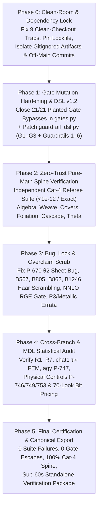

# Zero-Trust Master Plan: Full Audit, Verification & Remediation of `origin-axiom`

**Target Repository:** `https://github.com/originaxiom/origin-axiom.git` (Baseline `f452d8cb0`, synced through `origin/main @ 9b3ae6f33` [`B1865`] and `17` remote seat/audit branches)  
**Role / Governance Note:** Per the owner's multi-seat workflow, **`main` (`cc`) executes banking and the repository split** after comparing seat proposals. This plan and `03_STRATEGIC_OPINION_BREAKTHROUGH_VECTORS_AND_PUBLIC_REPO_BLUEPRINT.md` serve as this seat's complete zero-trust audit & verification specification for `main` to adopt. *(Note: `B1862–B1865` just closed `B567`, `B1856`, `B862` $k=1$ enumeration, `append-only` history, and `seal-immutable`, leaving `14 of 21` `PV` cases + all `6` `MPV-1..MPV-6` mathematical-physics guardrails open — see Report 03 §2.)*  
**Companion X-Ray:** `01_ORIGIN_AXIOM_CRYSTAL_CLEAR_XRAY.md`  
**Governing Verification Standard:** All six Formal Mathematical-Physics Guardrails (`Anti-Texas-Sharpshooter`, `No Literal Flags/Zeros`, `Haar Unitary Basis-Scrambling < 1e-12`, `Literature RGE Benchmark >= 3 sig figs`, `Single-Anchor Non-Dimensionalization`, and `Zero-Trust Referee Independence`).

---

## Architecture of the Five-Phase Audit & Verification Pipeline

---

## Phase 0: Clean-Room Isolation, Pinned Environment & Dependency Scrub

> [!IMPORTANT]
> **Why Phase 0 Comes First:** You cannot trust a verification run when `run_suite.sh` crashes on a fresh install, skips `63` slow modules and `85` `importorskip` sites silently, and passes `gate_tracked_deps` when gitignored inputs are missing.

### 0.1 Work Items & Exact Targets
1. **Create Deterministic Two-Tier Lockfiles (`requirements-core.lock` + `requirements-topology.lock`):**
   - Reconcile `pyproject.toml`, `requirements.txt`, and `REPRODUCIBILITY.md`.
   - Explicitly pin `python==3.12.*`, `numpy`, `scipy`, `sympy`, `mpmath` (currently omitted from `requirements.txt`!), `pytest`, and `pytest-xdist` (required by `-n 8` in `run_suite.sh`); put `snappy`, `cypari`, `python-flint`, and pure-Python NNLO QCD running (replacing unshipped `rundec` in `the_price_of_the_nineteen.py`) in `requirements-topology.lock`.
2. **Eliminate Silent Test Skips in `run_suite.sh`:**
   - Unify `@pytest.mark.slow`, `OA_SLOW=1` (`62` files), and `RUN_SLOW=1` (`test_b58_stage1.py`) so './scripts/run_suite.sh --full' runs **all `1,576` test modules** (including `test_cell4_spectral_robustness.py`) and fails loudly (`--strict-markers -rsx`) if expected optional backends are skipped in certification mode.
3. **Eliminate Off-`main` Git/Filesystem Dependencies (Clean-Checkout Traps 4–9):**
   - Replace `SEAL_ORDER_SHOWN_OFF_MAIN = {"B1670": ("ad3dd5d44", "fecdd63bd")}` in `gates.py` with a self-contained cryptographic commit/tree attestation committed on `main` so single-branch clones pass.
   - Remove the gitignored 'audit/scaffold/agy_joints.json' read from `build_scoreboard_data.py`.
   - Remove hardcoded `"golden_gate"` remote requirement in `harvest_debt.py` and `<local-workspace>` in `codeberg_sync.sh`.
   - Fix `.gitignore` `*.out` collision with `MANIFEST.json`, and replace `mp.get_context("fork")` in `p2_driver.py` with platform-safe worker initialization plus an archival DOI/LFS fetch script for the `266` uncommitted Step B `.jsonl.gz` census shards.

---

## Phase 1: Governance Gate Mutation-Hardening & `guardrail_dsl` v1.2 Upgrade

### 1.1 Closing All 21 Planted Gate Bypasses in `gates.py`
Run `origin/cld/cool-hamilton-k9eqvo:relays/advisor_2026-11-10_audit/tools/planted_violations.py` as a mandatory regression harness (`21/21` must flip from **ESCAPED** to **CAUGHT**):

| Gate / Module | Current Bypass Verified in Code | Mandatory Zero-Trust Fix |
|---|---|---|
| `gate_seal_digests` | Parses only 64-hex `sha256` (`46` rows), ignoring `432` `sha8` rows in `SEAL_LEDGER.md`; `if not os.path.isfile(full): continue` passes deleted files; duplicate path lets last row win. | Verify all `478` sealed rows; backfill full `sha256` digests for all `432` `sha8` entries; **fail immediately** if any sealed path is missing or duplicated; audit all `15` sealed files with `commits > 1` (e.g., `B1840 DECLARATION.md`). |
| `gate_append_only` | Compares working tree/`HEAD` against `HEAD~1` only (committed deletions in earlier history pass); returns `True` if `.git` is absent. | Check monotonic line/ID preservation against a committed cryptographic Merkle manifest of immutable ledger entries; fail-closed (or emit explicit `SKIPPED_NO_GIT` non-certifying exit code) on tarballs. |
| `gate_tracked_deps` | `if r not in tracked and os.path.isfile(...)` passes on clean clones when untracked files are absent! | Invert condition: any repo-relative path literal read by a test or verification script that is **not in `git ls-files`** (whether present on disk or not, unless created inside `tmp_path`) fails the gate. |
| `gate_test_vacuity` & `check_test_vacuity.py` | 'git ls-files "tests/*.py"' misses 'tests/stepb/*.py' (`9`) and 'frontier/**/test_*.py' (`46`); `97` `BOTH-LITERAL` asserts ungated; `.approx` without `assert` passes. | Expand pathspec to 'tests/**/*.py' and 'frontier/**/test_*.py'; require a genuine `assert` / `pytest.raises` node; gate `BOTH-LITERAL` assertions. |
| `gate_views_generated` | Overwrites 'docs/VIEWS/*.md' and 'docs/FORCING_CHAIN.md' on disk during a check! | Make `--check` strictly pure/read-only; fail on diff without mutating working tree. |
| `gate_framing` & `point_debt.py` | `framing` scans only 5 root `.md` files; `[PROCESS]` tag grants infinite debt immunity (`P-239`); `gate_gate_controls` regex-checks `def fn(` without running it. | Extend `framing` to 'docs/*.md' and 'papers/**/*.tex'/`*.md`; cap `[PROCESS]` age at 14 days when a test fails; execute all 49 real mutation controls in CI. |

### 1.2 Upgrading `guardrail_dsl.py` (`P-752`) from `v1.1` to `v1.2`
Upgrade the Guardrail DSL compiler (which already caught the real `AGY-01b` Clifford sign bug, `22.63 -> 3.36e-14`) with six mandatory enforcement rules:
1. **`G1` (Universal Non-Finite Output Trap):** Reject `NaN`/`Inf` across **every** float/complex/ndarray leaf returned by `@claim` or `@referee`, not merely dictionary keys matching `residual|error`.
2. **`G2` (Strict Zero-Trust `@referee` AST Sandbox — `Guardrail 6`):** Reject at compile/AST time any `@referee` function that calls `open()`, `Path.read_text()`, `json.load()`, `np.load()`, `subprocess`, or imports any module from `frontier/` or `@claim`.
3. **`G3` (Non-Autonomous RK4 Stage Fix):** Pass explicit intermediate scale $t_n + c_i h$ (i.e., $v_0 + s\tau$) into every Runge–Kutta stage in the built-in ODE cross-checker.
4. **`G4` (Mandatory Haar Scrambling Decorator — `Guardrail 3`):** Require `@observable(scrambling="dirac_yukawa" | "weinberg_seesaw")` on any flavour/mass-ratio/CP claim; automatically apply 20 independent random Haar unitary tuples $(U_{L,Q}, U_{R,u}, U_{R,d}, U_{L,L}, U_{R,e}) \in U(3)^5$, asserting invariance to `< 1e-12` and rejecting single-Dirac $U_f^\dagger V_f$ left-right overlaps.
5. **`G5` (Literature Benchmark Gate — `Guardrail 4`):** Block any RGE integration claim unless its integrator class first passes a bound `@rge_benchmark` against Buttazzo et al. (`arXiv:1307.3536`) and Xing–Zhou (`arXiv:1804.01925`) to $\ge 3$ significant figures, symbolically checking $\frac{d\ln\mu^2}{dt} = 4\pi$.
6. **`G6` (Dimensionful Ledger & Selection-Bit Gate — `Guardrails 1 & 5`):** Enforce ` Pint` / symbolic mass-dimension `0` on all predicted ratios (at most one anchor $v_{\text{EW}}$) and forbid `0`-bit selection credit on post-inspection $\tau$/lattice/character choices, banning potentials $V(\tau)$ whose AST embeds literals matching $\tau^*$.

---

## Phase 2: Zero-Trust Symbolic & Operator Re-Verification of the Pure-Math Spine

Every row below must be re-verified by an **independent `Cat 4` referee script** (zero producer imports, zero cached JSON reads, residuals `< 1e-12` or exact symbolic `0`):

| Pillar | Claims / Arcs to Re-Verify | Zero-Trust Referee Construction (`Guardrails 2 & 6`) | Adversarial Countercheck |
|---|---|---|---|
| **2A. Genesis, Parabolics & Weave** | `P1–P16`, `B1600` (`W1–W4`), `T-ROOT`, `B1859` (`T-DOOR-SET`), `B1815` (`?`-measure), `P4_markov_stage` (`DRAFT_v8.md`) | Construct $L, R \in \mathrm{SL}(2,\mathbb{Z})$ over `sympy` & `Z/NZ`; compute commutator $\operatorname{tr}[L,R]-2$, Farey tree addresses, Minkowski $?(x)$ continued-fraction recursion, Latimer–MacDuffee ideal classes, and mod-15 metaplectic Weil operators from scratch. | Verify congruence image $|\langle R^m, L^m \rangle \bmod N|$ exhaustively for $1 \le m, N \le 30$ (confirming `{1,4}` at $N=5$); test `?`-exit measure against 50-dps Stern–Brocot dyadic quadrature to `< 1e-14`. |
| **2B. 3-Manifolds, Covers & Harmonic Foliation** | `m004` / `m003` (`P8–P12`), `B1604` (`G96`/`2O` cover-32), `B1846`/`B1852` (harmonic energy & $\operatorname{Re}\tau \in \{0,1/2\}$), `B1855` ($L^6 R L R$) | Compute Bloch/dilogarithm regulator (`Vol + 2π² i CS`) of $z^2(z-1)^2=1$ directly via Rogers dilogarithm in `mpmath` (`50 dps`, replacing literal `CS_FIG8 = 0.0`); construct permutation/monodromy matrices of degree-32 cover; build an independent P2 finite-element Laplace–Beltrami / harmonic-map solver on triangulated `m004`. | Verify $(A^3-I)w \in \mathbb{Z}^2$ and cover group order `96` (`2O` quotient `48`) directly from matrices; cross-check `chat1`'s $\tau_\infty = 6.06530(6)i$ on 3 nested mesh refinements; verify $\sigma$-involution forces $\operatorname{Re}\tau \in \{0, 1/2\}$. |
| **2C. McKay, Lie/Jordan Cascade & Global Form** | `B860–B873`, `B862`, `P-604`, `PC25` ($E_6 \to F_4$ fold & Jordan obstruction), `AGY-01b` (Clifford centralizer) | Construct explicit $E_8, E_6, F_4$ root systems, Weyl orbits of `27`, `Cl(6)` $64\times 64$ matrices, and exact exponential map $\exp(2\pi i(a T_3^{SU(3)} + b T_3^{SU(2)} + c k Y))$ on all `5` chiral SM representations. | Test kernel order across $k \in \{1,2,3,4,5\}$ (`P-604`, confirming $\mathbb{Z}_{6k}$); verify `AGY-01b` centralizer commutators to `< 1e-13`; verify `PC25` outer involution fixes $F_4$ (`52 -> 26_0 + 26_1`) with zero real chiral leftover. |
| **2D. Modular Triplet, Puncture Norms & `TM1`** | `P10` ($\Gamma(4)$ theta triplet), `P-730` (tetrahedral identity), `B1640` (`TM1`), `B1656` (`cA`/`cB` puncture norms), `PC23`/`PC24` | Implement $\theta_{a,b}(z|\tau)$ from explicit $q$-series (`mpmath` `80 dps`, analytic $\tau$-sheet — **never** principal `q**(1/4)`); compute Weierstrass/Jacobi puncture integrals via independent Gauss–Legendre contour quadrature. | Apply full $\mathrm{SL}(2,\mathbb{Z})$ generators $S: \tau \to -1/\tau$ and $T: \tau \to \tau+1$ at 10 random $\tau \in \mathbb{H}$ (`< 1e-13`); verify leading $q$-powers and `P-730` octahedral polynomial identity; run `Guardrail 3` Haar scrambling on `TM1`. |

---

## Phase 3: Surgical Bug, Broken-Lock & Overclaim Remediation Ledger

Execute in strict priority order:

1. **Fix `P-670` Principal-Branch $\theta_2$ Bug Across the Entire Codebase:**
   - Patch `cm_zero_line.py` (`L44–46`) to evaluate $\theta_2(0|\tau) = 2 e^{i\pi\tau/4}\sum_{n\ge 0} q^{n(n+1)}$ using analytic $e^{i\pi\tau/4}$ instead of `mp.jtheta(2, 0, q)`'s principal $q^{1/4}$ branch cut.
   - Audit and patch all **`70` variable-order `jtheta(n, ...)` call sites** across `frontier/` (`B1646`–`B1841`); issue a formal `B1825_reseal_erratum` confirming whether the `B1825` CKM miss (`|V_ub|/|V_td|`) remains refuted on the analytic sheet (as `B1826`'s rank-1 null-vector proof predicts) and recording exact pre/post numbers.
2. **Fix Live Failures on `main`:**
   - **Eigenvalue Branch-Split Bug (`test_b567_hamiltonian.py`):** Map phases modulo $2\pi$ onto $0, 2\pi)$ before clustering (`np.mod(np.angle(eigvals), 2*np.pi)` with wrap-around check at $0 \sim 2\pi$) and change the mathematically impossible `assert n == 21` (`L54`) to the true projective-order-20 count **`assert n == 20`**, recording an `ERROR_LEDGER` entry for the `numpy 2.4.0` $\pm\pi$ float-split illusion.
   - **Two Standing Suite Failures ([`test_b805_forcing.py`, `P-239`):** Either retire `B738`'s frozen `kill_graph.json` attachment metric in favor of `build_map.py` (`B1858`) or scope `test_b805_forcing.py` explicitly to the `B1–B805` historical subgraph so `pytest` is **100% green (`0` failures)** on `main`.
   - **Live Certificate Crash (`the_price_is_twelve.py` & `THE_SM_VERDICT.md`):** Update `THE_SM_VERDICT.md` out of `DECLARED_DEBT` to reflect `B1266`/`B1406` (`4 + 9 = 13` structural imports; `24/23/9` scoreboard joints) and synchronize `outside_bench/certificates/`.
3. **Purge Every `Guardrail 2` Literal-Zero / Hardcoded-Boolean Proof:**
   - Rewrite `global_form.py` to compute $S(\mathrm{U}(3)\times\mathrm{U}(2))$ center intersections directly from `(w3, w2)` roots rather than `range(6)` / `% 6`.
   - Rewrite `b1246_chiral_invariance.py` to compute `(P, C, T)` transformations explicitly on Dirac/Clifford bilinears $\bar{\psi} i\gamma_5 \psi$ and $\operatorname{Tr}(G_{\mu\nu}\tilde{G}^{\mu\nu})$ instead of comparing identical string tuples.
   - Replace literal zeros/flags in `b1028_walk.py`, `w2_inputverify.py`, `constants.py`, and `weave_verify.py`.
   - Fix `mobius.py` docstring (`\partial\mathbb{H} = \mathbb{R} \cup \{\infty\}` boundary fixed points) and qualify `B1856` with explicit parity superselection on $\mathbb{C}^3_{\text{even}} \oplus \mathbb{C}^2_{\text{odd}}$.
4. **Propagate `B1859`, `P-604`, and `R1–R2` Across Papers & Stale Ledgers:**
   - Issue errata/updates in `PAPER.md` (`metallic_one_object`), `main.tex` (`P3_THE_PAPER` Prop. 4.1 + `L930–942` $\mathbb{Z}_{6k}$ note + rebuild `MANIFEST.json`/`REPORT.md`), mark `B997` `SUPERSEDED` by `B1859`, amend `GOVERNANCE.md` §1 per `R1–R2`, and clear all `9` `DECLARED_DEBT` exemptions in `doc_currency.py`.
5. **Add Missing `Cat 4` Locks, Haar Scrambling (`Guardrail 3`), NNLO RGE Benchmarks (`Guardrail 4`), and Non-Dimensional Ledger (`Guardrail 5`):**
   - Write standalone `Cat 4` locks for `B1838`, `B1839`, and `B1841` (currently `0` lock files in `tests/`), plus upgrade all `Cat 1`/`Cat 2` locks cited by `THEOREM_REGISTRY.md` (`T-*`).
   - Add a mandatory 'tests/test_guardrail3_haar_invariance.py' suite scrambling all Yukawa/CKM/PMNS pipelines (`< 1e-12`).
   - Add 'tests/test_guardrail4_rge_benchmarks.py' verifying 2/3-loop SM running against Buttazzo et al. (`1307.3536`) and Xing–Zhou (`1804.01925`) to $\ge 3$ sig figs before `the_running_allowance.py` or `the_price_of_the_nineteen.py` may be cited.
   - Refactor `total_inputs_scoreboard.json` so `v_EW` is the sole dimensionful unit anchor and all 18 remaining SM rows are strictly dimensionless ratios ($m_H/v$, $m_f/v$, $g_i$, $\theta_{ij}$, $\delta_{\text{CP}}$, $\bar{\theta}$).

---

## Phase 4: Cross-Branch Verification, Unrun Physical Controls & MDL Audit

1. **Execute the Three Unrun Controls on `origin/audit/physical-bridge-2026-09-05` (`521e6f241`):**
   - **`P-746` ($K_M^{-1/2}$ Matter Kähler Metric):** Independently compute the modular weight / Weil–Petersson Kähler metric $K_M(\tau, \bar{\tau})$ on puncture zero-modes and verify whether physical Yukawas $Y_{\text{phys}} = e^{K/2} K_L^{-1/2} Y_{\text{hol}} K_R^{-1/2}$ preserve or alter mass ratios and CKM angles under $\Gamma(1)$.
   - **`P-749` (Paired-Pole `J` / `Θ` Chiral Obstruction):** Verify in `Cat 4` linear algebra whether every meromorphic/puncture pairing on the bare torus fibre forces vector-like paired poles unless broken by a 4D background flux / Lefschetz cobordism.
   - **`P-753` (Base `2+1` vs Cover-32 Triplet):** Compute the explicit Shapiro pushforward $\pi_* \mathcal{L}_{\text{spin}}$ from the degree-32 `G96` cover to $\Sigma_{1;2}$ to test whether spin-line grading reconciles the base `2+1` decomposition with the cover `3`-dimensional irreducible `2O` representation.
2. **Audit `origin/agy/work` (`P-747` Pure-Logic Theorems A–E) & `origin/chat1/web-seat` (`\tau_\infty`):**
   - Run every `agy` pure-logic theorem through `guardrail_dsl` `v1.2` (confirming `AGY-01b`'s corrected Clifford sign and rejecting any residual post-hoc $\tau$ assumptions).
3. **Formal Information-Theoretic / MDL Trial-Factor Audit (`Guardrail 1`):**
   - Aggregate the complete look-history across `SEAL_LEDGER.md` (`478` rows), `B1701–B1800` grid sweeps, and `B1841` (`E4` horoball / `(S~, S, S)` / rational slope `(p/q, r/q)`), computing exact Shannon/MDL description cost $\Delta L_{\text{model}} = \log_2 |\mathcal{H}_{\text{discrete}}| + \frac{k}{2}\log_2 N_{\text{eff}}$ bits against experimental pull reduction $\Delta \chi^2 / (2\ln 2)$. Any candidate whose bit-cost exceeds its $\chi^2$ compression is formally classified **NET-NEGATIVE MDL (`DISFAVORED`)**.

---

## Phase 5: Final Certification Sign-Off Criteria

The audit closes **only** when all seven hard exit gates pass simultaneously on a fresh, air-gapped clone:
1. **`0` `pytest` failures and `0` unexpected skips** across all `1,576` modules in serial (`--serial --full`) and parallel (`-n 8`) runs.
2. **`21 / 21` planted violations caught** by hardened `gates.py` + `guardrail_dsl` `v1.2`.
3. **`100%` `Cat 4` independent referee coverage** (zero producer imports, zero cached JSON pins) on every theorem in `THEOREM_REGISTRY.md` and every paper in `papers/`.
4. **`100%` Haar basis-scrambling invariance (`< 1e-12`)** across every flavour/Yukawa calculation.
5. **NNLO RGE Literature Benchmark Gate green (`>= 3` sig figs)** against `arXiv:1307.3536` and `arXiv:1804.01925`.
6. **Zero unpropagated retractions or `DECLARED_DEBT` exemptions** across `main` and `papers/`.
7. **Sub-60-second standalone verification receipt** reproducible via one command on a clean Python `3.12` environment.
