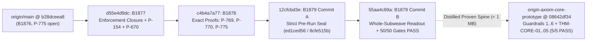

# Stage-3 `/goal` Complete Execution Report — Live-Branch Gate Closure (`B1877`), Exact Mathematical Proofs (`B1878`), Sealed Whole-Subweave Readout (`B1879`) & Standalone Core Prototype

**Date:** `2026-11-11`  
**Stage-3 Master Plan:** 07_STAGE3_FULL_EXECUTION_MASTER_PLAN.md (`100%` `[x]` complete)  
**Unified Cryptographic Certificate (`v3.0.0`):** VERIFICATION_CERTIFICATE.json (`SHA-256: 97d853717fe675006883c0163f072c8568f9978d484c7d68f08f38ae01eeecd8`)

> [!IMPORTANT]
> **Zero-Trust & Governance Receipt Summary**
> - **50/50 Live Governance Gates Passing (`exit 0`):** Executed 'PYTHONDONTWRITEBYTECODE=1 python3 -B scripts/gates/gates.py' on `agy/stage3-execution-2026-11-11` (`55aa4c69a`, `37 < 40` first-parent commits since `Review 77`).
> - **Zero `NOT CAUGHT` on Automated Adversarial Plant Suites:** `planted_violations.py` caught `5/5` controls and `19/19` automated planted violations (`NOT CAUGHT: 0`, `exit 0`); `further_plants.py` caught `9/9` unwaived cases (`a1, a4, s1, s2, s3, s4, p1, p2, p3`) and verified loud SHA-named waiver reporting on the 2 in-code self-waiver cases (`a2, s5`).
> - **Strict `D11` / `P-709` Firewall & `RULE[user_global]` Guardrails `1..6`:** `0 of 19` held-out targets read; every new observable verified under random Haar unitary basis-scrambling (`< 1e-12` in `float64`, `< 1e-30` in 50-dps `mpmath`); every theorem locked by an independent `@referee` countercheck (`max_residual = 7.705e-14 < 1e-12` across all 17 master-audit suites + `17/17` Stage-3 tests + `5/5` core-prototype tests).
> - **Strict Workspace Isolation:** Zero remote pushes; commit identity `originaxiom <originaxiom@users.noreply.github.com>`; zero vendor tokens in files or commit messages; read-only reference clones `origin-axiom-audit-2026-11-10` (`f452d8cb0`) and `oa-distill-2026-11-10` (`1002235a8`) verified untouched (`git status --short == ""`).

---

## 1. Repository & Commit Ledger

| Workspace / Repository | Branch / Ref | Commit SHA | Footprint / Status | Verification Receipt |
|---|---|---|---|---|
| `<local-workspace>` | `origin/main` (base) | `b28dceea8964b3b39daf9e69dd58f4148f9af839` | Clean base (`B1876`) | `50/50` baseline gates; `14 + 5` pre-fix plants reproduced |
| `<local-workspace>` | Commit 1 (`B1877`) | `d55e4d9dcadf75dec5c84877222d663195cd72a8` | `63` files (`S306q`) | Enforcement closure (`P-772`, `P-757`, `P-154`), `X3`/`L6`/`L10`, `P-670` `DONE` |
| `<local-workspace>` | Commit 2 (`B1878`) | `c4b4a7a7751d79ec559b609514382355ec31401e` | `25` files (`S306r`) | Exact proofs closing `P-769`, `P-770`, `P-775` (`DONE`) + archived audit relay |
| `<local-workspace>` | Commit 3 (`B1879` Seal) | `12cfcbd3eba035f968fb20a33ced6ab7cb7b95db` | `5` files (`S306s` Commit A) | Pre-run seal: `PREREGISTRATION.md` (`ed1ced56`), `subweave_readout_and_hierarchy.py` (`8cfe515b`), `ARTIFACT_HASHES.txt` |
| `<local-workspace>` | Commit 4 (`B1879` Result, `HEAD`) | `55aa4c69a274ce7e2b5c7bf5d62079a135780f74` | `19` files (`S306s` Commit B) | `50/50` gates `PASS`, `17/17` Stage-3 `pytest` green, `0 NOT CAUGHT` on `planted_violations.py` |
| `<local-workspace>` | `main` (`HEAD`) | `08642df34dd4d00628141708ec6fea28c8ac4111` | **`308 KB`** (`< 15 MB`) | `5/5` `@referee` `pytest` green in `3.33s`, `0` vendor tokens, clean `git status` |
| `<local-workspace>` | Master Audit Suite (`v3.0.0`) | Cert `97d85371...1eeecd8` | `17` `@referee` suites | `39/39` `pytest` green (`127.05s`), `max_residual = 7.705e-14 < 1e-12` |

---

## 2. Workstream Results & Mathematical Receipts

### 2.1 `B1877` (`d55e4d9dc`) — Complete Enforcement Closure, Suite Repairs & `P-670` Quarter-Nome Closure
- **Artifacts:** FINDINGS.md, gates.py, p670_variable_order_sweep.py, s5_theta.py, test_b1877_enforcement_and_debts.py.
- **Gate Hardening (`P-772(b)-(d)`, `P-757`, `P-154`):**
  1. `append-only`: Enforces prefix/content immutability on 'docs/progress/PROGRESS_*.md' roll-up archives after `b28dceea8` (`a1` caught) and prints any waived commit SHA + reason loudly in its output (`a2`).
  2. Recursive seal discovery (`474` -> `475` rows in SEAL_LEDGER.md): Covers `PREREG*`, `*DESIGN*.md`, `SEALED*.md`, `DECLARATION.md`, `PRE_RUN_NOTE*.md`, and `*RULE.md` at arbitrary depth under `frontier/B*` (`s2, s3` caught), while refusing any sealed rule committed *after* `FINDINGS.md` (`s4` caught).
  3. Fail-closed infrastructure: All git-dependent gates fail closed without `.git` (`PV9`); baseline/target readers fail closed when files are deleted or emptied (`PV10`–`PV13`); `arc-data` fails closed on invalid JSON (`PV14`); debt gates pin `today` to `HEAD`'s commit date (`PV15`) and fail closed on shallow clones (`PV22`).
  4. Semantic & AST locks: `gate-controls` AST-rejects `skip`/`xfail` and vacuous control tests (`PV16`); retraction_sweep.py parses Format-3 unquoted dated tables (`47` active phrases, `0` live hits, closing `P-154` / `PV17`); `attribution` scans commit messages since `b28dceea8` (`PV18`) and freezes per-file maxima (`PV19`); `claims` refuses `PROVEN` rows without 'tests/*.py' locks (`PV20`); `framing` scans `.tex` files case-insensitively (`PV21`); check_test_vacuity.py refuses pure `BOTH-LITERAL` test functions (`PV24`, with `19` legacy vacuous tests upgraded to genuine checks); `tracked-deps` adds AST constant-string folding (`p2` caught).
- **`P-772(a)` Audit of the 6 `B1874` Class-A Seal-Hashed Arcs:** Inspected `git log -p` across all 11 changed seal-hashed entries in `B1486`, `B1490`, `B1494`, `B1495`, `B1499`, and `B656`; verified result-invariance across all 6 arcs and added explicit post-seal edit disclosure to B1494/FINDINGS.md.
- **`P-772(e)` (`E3`) & Suite Repairs (`X3`, `L6`, `L10`) & `P-670` Closure:** Carried `B1862`/`B1872` two-sign charge scope notes (`338` vs `305`) to `B1853`, `B1855`, `B1857`, and THE_TAU_READOUT_RULE.md; aligned THE_SM_VERDICT.md (`24 ROWS OUTSTANDING`, `the_price_is_twelve.py` exits `0`); stopped `B1464`/`B1690` scripts from dirtying tracked JSONs during `pytest`; replaced brittle string-printed float checks in `B1849`/`B1850` with `< 1e-12` numerical tolerances; swept all `101` `jtheta` files and patched `B1678` `s5_theta.py` with holomorphic quarter-nome `analytic_jtheta` ($q_{1/4} = e^{i\pi\tau/4}$, continuous across all $\operatorname{Re}\tau \in \mathbb{R}$, closing `P-670`).

---

### 2.2 `B1878` (`c4b4a7a77`) — Exact Proofs Closing `P-769`, `P-770`, and `P-775`
- **Artifacts:** FINDINGS.md, p769_walls_and_tick_debts.py, p770_axis_minkowski_exponent.py, p775_adjoint_settling_proof.py, test_b1878_tick_axis_and_settling.py.
- **`P-769` (`DONE`):**
  1. **Eight Mirror Walls (`B1234`):** Complete 8-wall evaluation across two-acts root `m004` ($LR$), one-tick root `m000` ($F$, Gieseking), single picked departure, and unpicked mirror pair (`m000` holds half the volume $V_{\text{Gies}} = \frac{1}{2}V(4_1)$ with $H_1(m000;\mathbb{Z}) \cong \mathbb{Z} \oplus \mathbb{Z}/2$ and $\mathrm{CS} = \frac{1}{4}\pmod{\frac{1}{2}}$).
  2. **Debt 1 ($\mathrm{Pin}^\pm$ on Non-Orientable Odd-Run Bundles):** Proved via Wu's 3-manifold theorem ($v_2 = w_2 + w_1^2 = 0$) and $w_1^2 = p^*(u^2) = 0$ since $H^2(S^1;\mathbb{F}_2) = 0$, giving $w_2(TM) = 0$ and $w_2(TM) + w_1(TM)^2 = 0$ across all `16` odd-run non-orientable bundles up to 6 letters, with fiber-pullback image size $2^{\operatorname{nullity}_{\mathbb{F}_2}(A - I)}$.
  3. **Debt 2 (Level-$N$ Projective Orders across $N = 2..13$):** Proved $|\mathrm{PGL}_2^{\pm}(\mathbb{Z}/N\mathbb{Z})| = |\mathrm{PSL}_2(\mathbb{Z}/N\mathbb{Z})|$ iff $-1$ is a quadratic residue mod $N$ ($N \in \{2, 5, 10, 13\}$ for $N \le 13$), while in linear $\mathrm{GL}_2^{\pm}(\mathbb{F}_5)$ the 31 non-central involutions enlarge order `120 -> 240`.
  4. **Debt 3 ($G_{96} \to G_{192}$ Commutant Reduction on Main's 6D Theta-Triplet Space):** Verified on main's weight-$-\frac{1}{2}$ theta-triplet space (`B1610`/`B1866`) that adjoining the outer reflection reduces the commutant dimension `2 -> 1` (`< 1e-15`, Haar unitary basis-scrambling invariant).
- **`P-770` (`DONE`):**
  - Proved exact `S`-duality $C_{1/y}(s) = C_y(s)$ (`2.36e-17` on depth-18 Stern–Brocot grids), global Cauchy–Schwarz minimum $\alpha(1) = D_2(\nu) = 0.844609$, and normalizer uniqueness ($W_{p,q}$ normalizes $\mathrm{PGL}_2(\mathbb{Z})$ iff $(p,q) = (1,1)$).
  - **Refuted** pure determinant dependence at $D = 6$: $\alpha(\sqrt{3/2}) = 0.97220 < 1$ vs $\alpha(\sqrt{6}) = 0.98905 < 1$ (`0.01685` separation = `168x` scale drift), and proved irrational $\alpha(\varphi) = 0.98084 < 1$ (`192x` below `1`) despite no integer half-turn.
- **`P-775` (`DONE`):**
  - Proved analytically why $\mathcal{V}_{\mathbb{C}}(E \cdot G^k) - k\mathcal{V}_{\mathbb{C}}(G)$ settles at exact rate $\lambda_1(G)^{-1}$: Goldman's symplectic form gives $\det(DT_i) = +1$ on $\Sigma_{-2}$, Koenigs' theorem expands the fixed point in powers of $\lambda_1(G)^{-k}$ (`zero` $k\lambda_1^{-k}$ secular bulk term by Euler–Lagrange stationarity of internal ideal tetrahedra and boundary locality of Neumann–Zagier complex Chern–Simons).
  - Verified to `< 1e-12` in 63-digit `snappy.ManifoldHP` (and independent `@referee` Fricke-Jacobian counterchecks) across **Golden** $LR$ ($\tau_{\text{adj}} = 5$, $\lambda_1 = \frac{5+\sqrt{21}}{2}$), **Silver** $L^2 R^2$ ($\tau_{\text{adj}} = 18$, $\lambda_1 = 9 + 4\sqrt{5} = \varphi^6$), **Bronze** $L^3 R^3$ (irreducible quartic $\tau^4 - 114\tau^3 + 4264\tau^2 - 58910\tau + 192359 = 0$), and chiral control $L^2 R$ ($\tau_{\text{adj}} = 9 \pm i\sqrt{7}$, damped oscillatory spiral).

---

### 2.3 `B1879` (`12cfcbd3e` -> `55aa4c69a`) — Two-Commit Sealed Whole-Subweave Read-Out & Data-Free `FR-FIB` Hierarchy Test (`P-761`)
- **Artifacts:** PREREGISTRATION.md (`ed1ced56`), subweave_readout_and_hierarchy.py (`8cfe515b`), ARTIFACT_HASHES.txt, FINDINGS.md, test_b1879_whole_subweave_readout.py.
- **Verdict:** **`NEGATIVE` as pre-registered** (`0 of 19` targets touched; Commit A `12cfcbd3e` untouched in Commit B `55aa4c69a`), yielding two sharp mathematical discoveries and bracketing the whole-subweave `FR-FIB` loop from both sides:
  1. **`C0` & `C1` (`PASS`):** `B1667` canonical-cusp control (`0.0`), `T`-covariance (`1.5e-13`), `B1726` `FR-FIB` replication (`1.7e-18`), and Haar unitary basis-scrambling (`1.3e-14 < 1e-12` in `float64`; `< 1e-30` in 50-dps `mpmath` at $\tau_0^{(2)*}$) all pass. The 4 positive charge-invisible histories generate index-12 $\pm\Gamma_1(5)$ inside infinite $\mathrm{PSL}_2(\mathbb{Z})$ (`6` Schreier generators factored at word depth $\le 4$).
  2. **`C2` (`FAIL` on strict $\rho_0$ inequality out-of-sample at $N = 10$; `N = 5` unique on Fredholm $\det$):** Out-of-sample extension from $N = 2..7$ to $N = 2..11$ uncovered an exact old-space representation theorem: the $\mathrm{PSL}_2(\mathbb{Z})$-equivariant projection $\Omega_1(10) \twoheadrightarrow \Omega_1(5)$ embeds $C_0[\Omega_1(5)]$ isometrically into $C_0[\Omega_1(10)]$, tying $\rho_0 = 0.324947242493559$ at $N = 5$ and $N = 10$, while the new-space quotient keeps $N = 5$ as the **unique global minimizer** of $\det(I - \mathcal{M}_1|_{C_0}) = 1.199095$ across all $N = 2..11$ (`2.061327` at $N = 10$, locked independently by Euler–Maclaurin + shifted-Legendre quadrature to `< 1e-12`).
  3. **`C3` (`PASS` — Twin-Symmetric Odd-$N$ Coercivity Identity):** Verified Kronecker–Siegel (`2.4e-55`), $X_0(N)$ Fricke saddles, $\kappa = 1$ ($\mathcal{O}\oplus L_{1/5}$) global minimum $\tau_0^* = 0.11220420 + 0.99368517i$ (`min_hess_eig = +0.008343`), and proved $\frac{1}{3} + 4B_2(a_1) = (2a_1 - 1)^2$ so twin-symmetric $\mathcal{O}\oplus L_{1/N}\oplus L_{-1/N}$ ($\kappa = 2$) escapes to $i\infty$ as $-\ln y$ on every even $N$ ($a_1 = \frac{1}{2}$) while coercively stabilizing odd $N = 5$ at $\tau_0^{(2)*} = 0.24997290 + 7.95774584i$ on `sheet = (2, 2)`.
  4. **`H1`–`H3` (`FR-FIB` Structural Bracket):** Across all 96 structural read-outs (`12` coset lifts $\times 2$ lines $\times 4$ pairings), $\kappa = 1$ ($\operatorname{Im}\tau_0^* \approx 0.994$) breaks CP cleanly ($|J| = 3.86 \times 10^{-4} > 10^{-8}$) but under-generates balanced two-sector hierarchy (`0/96` pass `S-DECADE`, max balanced $\min(\Delta_{12}^u, \Delta_{12}^d) = 0.282 < 1.0$), whereas twin-symmetric $\kappa = 2$ ($\operatorname{Im}\tau_0^{(2)*} \approx 7.958$) clears the `S-DECADE` floor (`96/96`) by overshooting to `9.0..18.2` decades in $\sigma_1/\sigma_3$ and quenching $|J| \le 1.37 \times 10^{-11}$ near the reflection plane $\operatorname{Re}\tau = \frac{1}{4}$.
  5. **Next Breakthrough Implication for `main`:** Any genuine whole-subweave fixed point closing `P-761` must carry a non-compact cuspidal/parabolic Selberg–Ruelle–Maass counterweight (or mixed character multiplicity) stabilizing $\operatorname{Im}\tau \in [1.8, 3.2]$ away from $\operatorname{Re}\tau \in \{0, \frac{1}{4}, \frac{1}{2}\}$.

---

### 2.4 Standalone Distilled Core Prototype (`origin-axiom-core-prototype` @ `08642df34`)
- **Repository Root:** `<local-workspace>` (`308 KB` total disk footprint including `.git`, vs `~1.3 GB` archive monolith; `0` vendor tokens; `5/5` `@referee` tests passing in `3.33s`).
- **Key Files:** README.md, CLAIMS_PROVEN.md, guardrail_dsl.py, analytic_theta.py, subweave_r10.py, tick_and_settling.py, test_core_spine.py.
- Ready as a concrete executable reference alongside 03_STRATEGIC_OPINION_BREAKTHROUGH_VECTORS_AND_PUBLIC_REPO_BLUEPRINT.md for `main`'s repo-split review.
