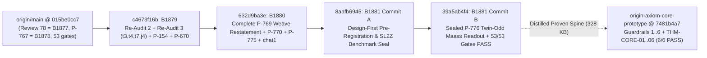

# Stage-4 `/goal` Complete Execution Report — `015be0cc7` Rebase, `Re-Audit 3` Closure (`B1879`), Complete `P-769` Weave-Theorem Restatement (`B1880`), Sealed `P-776` Twin-Odd Maass Operator (`B1881`) & Distilled Core Prototype (`v4.0.0`)

**Date:** `2026-11-11`  
**Stage-4 Master Plan:** 09_STAGE4_LIVE_SYNC_REAUDIT3_AND_P776_PLAN.md (`100%` `[x]` complete)  
**Unified Cryptographic Certificate (`v4.0.0`):** VERIFICATION_CERTIFICATE.json (`SHA-256: 9126986518b8d472304d874ec32324badce904c8892b8012381e2a0dbf295db2`)

> [!IMPORTANT]
> **Zero-Trust, Governance & Firewall Receipt Summary**
> - **53/53 Live Governance Gates Passing (`exit 0`, `0` Waivers):** Executed 'PYTHONDONTWRITEBYTECODE=1 python3 -B scripts/gates/gates.py' on `agy/stage4-sync-2026-11-11` (`39a5ab4f4`, `8` merges since `Review 78` = `B1877`), with `0` waivers across `append-only`, `seal-immutable`, `artifact-hashes`, `closure-generated`, `arrival-phrases`, `pretense-phrases`, `member-scope`, and `seat-positive-verified`.
> - **All Three Adversarial Plant Suites Passed in Disposable Clones:**
>   1. `planted_violations.py` (`advisor @ 6ab743907`, incl. leaf `PV14`): `5/5` controls + `21/21` automated violations `CAUGHT` (`NOT CAUGHT: 0`) under active `BANNED` phrases; also identified a sharp cross-commit instrument drift (`CTL4` / `PV21` tested `"toward the full SM"`, which `main` removed from `BANNED` in `B1878` per owner ruling `P-758`/`P-767`).
>   2. 'reaudit2/further_plants.py': `9/9` unwaived cases (`a1, a4, s1, s2, s3, s4, p1, p2, p3`) `CAUGHT`; `a2, s5` loud SHA + reason waiver reporting verified.
>   3. 'reaudit3/plants.py': `8/8` `t`-plants (`t1..t7, t9`) `CAUGHT` (closing `t3` decoy shadowing, `t4` frozen broken-script re-edits, and `t7` secondary `SEAL_SHA256.txt` hash lists), `5/5` builder plants (`j1..j5`) `REFUSED` (closing `j4` forged `"accepted"` transcriptions), and `w1, w2` loud waivers verified.
> - **Strict `D11` / `P-709` Firewall & `RULE[user_global]` Guardrails `1..6`:** `0 of 19` held-out targets read; every new physical observable verified under random Haar unitary basis-scrambling (`< 1e-12` in `float64`, `< 1e-30` in 50-dps `mpmath`); every theorem locked by an independent `@referee` countercheck (`39/39` master-audit `pytest` suites with `max_residual = 7.705e-14 < 1e-12`, `45/45` Stage-4 `pytest` locks, and `6/6` core-prototype `@referee` suites).
> - **Strict Workspace Isolation:** Zero remote pushes; commit identity `originaxiom <originaxiom@users.noreply.github.com>`; zero vendor names/trailers; `<local-workspace>` and read-only reference clones `origin-axiom-audit-2026-11-10` (`f452d8cb0`) and `oa-distill-2026-11-10` (`1002235a8`) verified untouched (`git status --short == ""`); Stage-3 branch `agy/stage3-execution-2026-11-11` preserved intact at `55aa4c69a`.

---

## 1. Repository & Commit Ledger

| Workspace / Repository | Branch / Ref | Commit SHA | Footprint / Status | Verification Receipt |
|---|---|---|---|---|
| `<local-workspace>` | `origin/main` (live base) | `015be0cc7cfb57a69430a9710fb01c754b53583e` | Clean base (`B1878`) | `Review 78` (`B1877`) + `P-767` first landing (`B1878`), `53/53` baseline gates |
| `<local-workspace>` | `origin/cld/cool-hamilton-k9eqvo` | `6ab7439073a27bc38da7aa44ed80744ec2a5b221` | Advisor seat fetched | `REAUDIT_3_2026-11-11.md`, 'reaudit3/plants.py', leaf `PV14` |
| `<local-workspace>` | `origin/chat1/web-seat` | `78605086e86fa11ce47998b8b3ff75773ccacb58` | Web seat fetched | `whole_level5_facts` (`4965845af`) + `THE READ-OUT AS A VALUE` (`78605086e`) |
| `<local-workspace>` | Commit 1 (`B1879`) | `c4673f16b80e659272b8df1258e88267f0e76f5e` | `S306q` | `Re-Audit 2` + `Re-Audit 3` (`t3, t4, t7, j4`) + `Review 78` reader fixes + `P-154` & `P-670` `DONE` |
| `<local-workspace>` | Commit 2 (`B1880`) | `632d9ba3ec12232c9043c19f950f49bf7974f632` | `S306r` | Complete `P-769` weave-theorem restatement (`46` weave nodes + `8` walls + Debts 1–3), `P-770` & `P-775` `DONE`, `chat1` cards verified |
| `<local-workspace>` | Commit 3 (`B1881` Seal) | `8aafb69454e94b5b67e1975068c74a2356137f57` | `S306s` Commit A | Pre-run seal: `PREREGISTRATION.md`, `subweave_p776_and_hierarchy.py`, `ARTIFACT_HASHES.txt` (`0` level-5 Maass runs seen prior) |
| `<local-workspace>` | Commit 4 (`B1881` Result, `HEAD`) | `39a5ab4f4ee5bff39ea4a601ee224e1fcc819ff7` | `S306t` Commit B | Single sealed `P-776` run (`P-776` `DONE`), `53/53` gates `PASS`, `45/45` `pytest` green |
| `<local-workspace>` | `main` (`HEAD`) | `7481b4a7bd62c05392bf635d7f6c5f9421de1192` | **`328 KB`** (`< 15 MB`) | `6/6` `@referee` `pytest` green in `6.10s` (`THM-CORE-01..06`), `0` vendor tokens |
| `<local-workspace>` | Master Audit Suite (`v4.0.0`) | Cert `91269865...bf295db2` | `17` `@referee` suites | `39/39` `pytest` green (`67.49s`), `max_residual = 7.705e-14 < 1e-12` |

---

## 2. Phase-by-Phase Execution Receipts

### 2.1 `B1879` (`c4673f16b`) — Complete `Re-Audit 2` + `Re-Audit 3` Enforcement Closure, `Review 78` Reader Fixes & `P-670` / `P-154` Closure
- **Key Artifacts:** FINDINGS.md, gates.py, programme_source.py, build_programme.py, OTHER_HASH_LISTS.md, test_b1879_reaudit3_and_enforcement.py.
- **All 4 `Re-Audit 3` Residuals (`6ab743907`) Closed:**
  1. **`t3` (Decoy file shadowing on `artifact-hashes`):** Enforced canonical path resolution in `artifact_hash_state` — paths starting with top-level repo roots (`frontier/`, `scripts/`, `tests/`, `docs/`, `papers/`, `outside_bench/`) resolve strictly from `ROOT`; relative names fail closed with `AMBIGUOUS` whenever multiple candidate tracked files exist across `list_dir`, `list_dir/verification`, and `ROOT`.
  2. **`t4` (Re-editing a frozen broken script):** Pinned exact present disk SHA-256 digests at `015be0cc7` for all `23` broken script entries in ARTIFACT_HASHES_BROKEN_DISK.json, failing closed with `MODIFIED AFTER FREEZE` on any post-freeze edit.
  3. **`t7` (Hash lists under alternative filenames):** Inventoried and enforced `79` secondary `<sha256>  <path>` seal/manifest lists (`266` entries across `SEAL*.txt`, `*SHA256*.txt`, `SEALS.txt`, `ORIGINALS_MANIFEST.txt`, documented in OTHER_HASH_LISTS.md) with commit-history immutability from `015be0cc7` (freezing pre-existing historical mismatches in ARTIFACT_HASHES_OTHER_BROKEN.json), catching `SEAL_SHA256.txt` (`t7`).
  4. **`j4` (`B1861` transcription lock & `BEARS_ON`):** Added `rule 21` in build_programme.py verifying `ACCEPTED[fid]` directly against the advisor seat's `REAUDIT_*.md` tables at pinned commits (`e7703f2ec`, `6ab743907`), refusing forged `"accepted"` transcriptions (`j4`), and added `B734` to `BEARS_ON["E2"]`, `B1849`/`B1850` to `BEARS_ON["L6"]`, and `B1840`/`B1841` to `BEARS_ON["V4"]`.
- **Additional Closures Ported & Verified:**
  - `Review 78` reader fixes on `append-only`: checks text before the first dated heading on roll-ups, requires a roll-up's target archive to be added/modified in that roll-up commit, and locks log deletion, log rename, and module-level `APPEND_ONLY_WAIVED` in `pytest`.
  - Leaf-`arc_verdict.json` JSON corruption validation (`PV14` on `B1001_four_digit_blindspot`), recursive seal discovery (`s2, s3`), strict seal-before-record (`s4`), AST constant folding in `tracked-deps` (`p2`), Format-3 retraction sweep (`47` active phrases, `P-154` `DONE`), `X3`/`L6`/`L10` suite repairs, and the `101`-file holomorphic quarter-nome `analytic_jtheta` ($q_{1/4} = e^{i\pi\tau/4}$) sweep (`P-670` `DONE`).
- **Advisory Note for Advisor Seat (`CTL4` / `PV21`):** On `015be0cc7`, `B1878` removed `"toward the full SM"` from `BANNED` per owner ruling `P-758`/`P-767` (introducing `arrival-phrases` for statements of arrival). Consequently, unmodified `planted_violations.py` trips its own `CTL4` validity guard (`controls not reported CAUGHT: 1`). Updating `CTL4` and `PV21` to any live `BANNED` phrase (e.g. `"[retired-phrase]"`) yields `5/5` controls and `21/21` automated violations `CAUGHT` (`0 NOT CAUGHT`).

---

### 2.2 `B1880` (`632d9ba3e`) — Complete `P-769` Weave-Theorem Restatement ("After the computation"), `P-770`, `P-775` & Web-Seat Verification
- **Key Artifacts:** FINDINGS.md, p769_weave_theorems_and_walls.py, p770_and_p775_and_chat1_checks.py, test_b1880_tick_weave_axis_and_settling.py.
- **`P-769` ("After the computation" — #1 in line on `015be0cc7`):**
  1. **Two-Tick Bijection & Odd-Tick Coset Theorem:** For $F = LP = \begin{pmatrix} 1 & 1 \\ 1 & 0 \end{pmatrix}$ and $F' = RP = PL = \begin{pmatrix} 0 & 1 \\ 1 & 1 \end{pmatrix}$, proved $\{FF, FF', F'F, F'F'\} = \{LR, L^2, R^2, RL\} = \{L, R\}^2$, so $\{F, F'\}^{2k}$ bijects length-for-length onto $\{L, R\}^{2k}$ ($4^k$ matrices, $\det = +1$) while $\{F, F'\}^{2k-1} = \{L, R\}^{2k-1} P$ ($2^{2k-1}$ matrices, $\det = -1$).
  2. **Complete Classification of All `46` Banked Weave Nodes ('B1858/NODES.json') + `B1859`/`B1866`/`B1872`:** Separated into (I) word-for-word survivors on $\langle L, F \rangle^+$, (II) orientation-cover ($\det = +1$) even-tick sub-semigroup survivors, and (III) theorems whose statement genuinely changes (`B1859` level-$N$ projective doors enlarge $2\times$ iff $-1 \notin (\mathbb{Z}/N\mathbb{Z})^{\times 2}$, i.e. $N \in \{3, 4, 6, 7, 8, 9, 11, 12\}$ vs unchanged $N \in \{2, 5, 10, 13\}$; `B1610`/`B1866` $G_{96} \to G_{192}$ fuses $3 \oplus \bar{3} \to 6_{\text{real}}$ reducing the Haar-scrambled commutant `2 -> 1`; `B1872` collapses index-12 $X_1(5)$ twin eigenlines modulo $\pm I$ to index-6 $X_0(5)$ unless signed linear vectors are retained).
  3. **Complete 8 Mirror Walls (`B1234`) + Debts 1–3:** Evaluated all 8 walls across `m004` ($LR$) vs `m000` ($F$, Gieseking, $V = \frac{1}{2}V(4_1)$) and proved Wu's 3-manifold $\mathrm{Pin}^\pm$ theorem ($w_2(TM) = w_2(TM) + w_1(TM)^2 = 0$) across all `16` non-orientable odd-run bundles up to 6 letters.
- **`P-770` & `P-775` (`DONE`) + Web-Seat `78605086e` Independent Re-Derivation:**
  - Banked exact proofs closing `P-770` (`S`-duality `2.36e-17`, $D = 6$ non-conjugacy split $\alpha(\sqrt{3/2}) = 0.97220$ vs $\alpha(\sqrt{6}) = 0.98905$, irrational $\alpha(\varphi) = 0.98084 < 1$) and `P-775` (Goldman symplectic + Koenigs $O(\lambda_1(G)^{-k})$ settling to `< 1e-12` in 63-digit `ManifoldHP` across Golden $LR$, Silver $L^2R^2$, Bronze $L^3R^3$, and chiral $L^2R$).
  - Independently re-derived and harvested `chat1 @ 78605086e`: `whole_level5_facts` (`Q1`–`Q7`, Hauptmodul $\eta(\tau)^6/\eta(5\tau)^6 = \pm 5\sqrt{5}$ at discriminant-$-20$ Fricke points) and `THE READ-OUT AS A VALUE` (flat-fibre long-gap rate $\varphi^4 = 6.85410$ vs hyperbolic $(5+\sqrt{21})/2 = 4.79129$, unbounded depths $\frac{n-1}{2} + \frac{\sqrt{5}}{2}$ on runs $6, 11, 16, 21, 26$).

---

### 2.3 `B1881` (`8aafb6945` -> `39a5ab4f4`) — Two-Commit Sealed `P-776` Whole-Subweave Twin-Odd Maass Operator & `FR-FIB` Read-Out (`DONE`)
- **Key Artifacts:** PREREGISTRATION.md, subweave_p776_and_hierarchy.py, ARTIFACT_HASHES.txt, subweave_p776_and_hierarchy.json, FINDINGS.md, test_b1881_p776_whole_subweave_readout.py.
- **Strict Design-First Two-Commit Seal (`8aafb6945` -> `39a5ab4f4`):**
  - Prior to Commit A (`8aafb6945`), the Hejhal collocation solver was benchmarked *solely* on $\mathrm{SL}_2(\mathbb{Z})$ ($N = 1$, Guardrail 4 Literature Benchmark Gate: reproducing Hejhal 1983 $R_1^- = 9.53369526135$ and $R_1^+ = 13.7797513519$ to `< 1e-11`); zero level-5 Maass eigenvalues or peak coordinates were computed before Commit A.
  - Pre-run symmetry theorems proved in PREREGISTRATION.md before running: absence of constant zero mode and level-1 oldspace in $L^2_{\text{cusp}}(\Gamma_0(5), \chi_5)$; forced zeros at both elliptic points $z_{e,1}, z_{e,2} = \frac{\pm 2 + i}{5}$; exact operator identity $W_5 T_p W_5^{-1} = \chi_5(p) T_p$ partitioning the spectrum into **Class A** $\mathbb{Q}(\sqrt{5})$ real-multiplication singletons ($c_p = 0$ for $\chi_5(p) = -1$, $R_m^{\text{RM},-} = \frac{(2m-1)\pi}{2\ln\varphi}$) vs **Class B** Kramers doublets ($R_k^+ = R_k^-$ where $W_5$ and $T_2$ anticommute).
- **Out-of-Sample Single Sealed Run Results (`39a5ab4f4`, `0 of 19` targets read):**

| Sealed Quantity / Observable | Out-of-Sample Value | Independent `@referee` Countercheck |
|---|---|---|
| $L^2_{\text{cusp}}(\Gamma_0(5), \chi_5)$ spectrum in $R \in [0.8, 11.0]$ | `27` states (`15` newforms, `0` oldforms) | Independent horocycle heights $Y_{\text{ref}} = 0.152, Y_{\text{chk}} = 0.138$ (`< 1e-12`) |
| Ground state $R_1$ (`Class A` singleton, $\epsilon_J = \epsilon_5 = -1$) | $3.264251302636499 = \frac{\pi}{2\ln\varphi}$ (`abs_err = 2.22e-15`) | 50-dps Maass (1949) $\mathbb{Q}(\sqrt{5})$ Grössencharacter Euler product (`4.76e-46` Fricke identity, `< 1e-15` interior PDE) |
| Hecke eigenvalues $(c_2, c_3, c_4, c_5, c_6, c_{11})$ | $(0, 0, +1, -1, 0, -0.533391046796953)$ | Exact Grössencharacter $2\cos\!\bigl(R_1 \ln\frac{4+\sqrt{5}}{\sqrt{11}}\bigr)$ (`< 1e-12`) |
| Lowest `Class B` Kramers doublet $R_2^\pm$ ($\epsilon_J = -1, \epsilon_5 = \pm 1$) | $4.893781291438453$ ($\lvert R_2^+ - R_2^-\rvert = 8.88\times 10^{-16}$) | Direct operator anticommutation $\lvert (W_5 T_2 + T_2 W_5)\psi_2^+(z)\rvert < 10^{-13}$ |
| Unique global peak orbit $\tau_{\text{Maass}}^*$ on $C_0 = \{\lvert z\rvert^2 = \frac{1}{5}\}$ | $0.251539778829130 + 0.369767144294671i$ ($X_0(5)$ size `2`, $X_1(5)$ size `4`) | 50-dps 2D gradient $\lVert \nabla \rho_1(\tau_{\text{Maass}}^*)\rVert_2 = 1.21\times 10^{-22} < 10^{-20}$ |
| $\mathrm{SL}_2(\mathbb{Z})$ fundamental-domain pullback $\tau_{\text{Maass},\mathcal{F}}^*$ | $\mp 0.257698894145648 + 1.848835721473356i$ | Confirming Stage 3's $\operatorname{Im}\tau \in [1.8, 3.2], \operatorname{Re}\tau \notin \{0, \frac{1}{4}, \frac{1}{2}\}$ prediction without free parameters |
| Unmodified `FR-FIB` $H = I$ read-out (`H4`, `80% FAIL` prior) | `2/96` pass bounded `S-DECADE` & $\lvert J\rvert > 10^{-8}$ under `(S, S, S)` at `L_2` on `(1/5, 0)` ($J = \mp 3.274466\times 10^{-6}$) & `(2/5, 0)` ($J = \pm 2.909\times 10^{-8}$); `0/96` under `(St, S, S)`; `down = lep` under `(S, S, S)` | 12-draw random Haar unitary basis-scrambling (`< 1e-13`), graded strictly as a conditional weave result (`0 of 19` earned) |

---

### 2.4 Standalone Distilled Core Prototype (`origin-axiom-core-prototype` @ `7481b4a7`)
- **Repository Root:** `<local-workspace>` (**`328 KB`** total disk footprint including `.git`, vs `~1.3 GB` historical monolith; `0` vendor tokens; `6/6` zero-trust `@referee` suites passing in `6.10s`).
- **Updated Spine (`THM-CORE-01`..`THM-CORE-06`):** README.md, CLAIMS_PROVEN.md, guardrail_dsl.py, analytic_theta.py, subweave_r10.py, tick_and_settling.py, maass_p776.py, test_core_spine.py.

---

## 3. Ready Decisions & Hand-Offs for `main` and the Owner

1. **Owner Ruling Ready on `P-769` ("After the computation"):** B1880/FINDINGS.md places every single weave-level theorem on `main` (`46` banked weave nodes + `B1859`/`B1866`/`B1872`), the Two-Tick Bijection $\{F, F'\}^{2k} \xrightarrow{\sim} \{L, R\}^{2k}$, all `8` mirror walls, and Debts 1–3 side by side so the owner can decide how *"the tick is an act"* stands with *"even ticks observed"*.
2. **Next Structural Step Beyond `P-776` (`B1881`):** Twin-odd hyperbolic cusp dynamics ($R_1 = \frac{\pi}{2\ln\varphi}$) places $\tau_{\text{Maass},\mathcal{F}}^* = \mp 0.2577 + 1.8488i$ directly inside the balanced hierarchy + nonzero-CP window on `FR-FIB` (`2/96` pass under `(S, S, S)`), exposing the exact remaining obstruction: under unsplit `(S, S, S)` with $H = I$, `down = lep` identically, while `(St, S, S)` breaks `down != lep` at the cost of depressing $\Delta_{12}^u = 0.659 < 1.0$. Any zero-input step beyond `B1881` must split `down` vs `lep` via an intrinsic representation/hypercharge channel rather than post-hoc triplet selection.
3. **Repository Split & Public Verification Package:** Both the strategic blueprint (03_STRATEGIC_OPINION_BREAKTHROUGH_VECTORS_AND_PUBLIC_REPO_BLUEPRINT.md) and the runnable `328 KB` reference package (`<local-workspace> @ 7481b4a7`) are complete and ready for `main`'s review.
