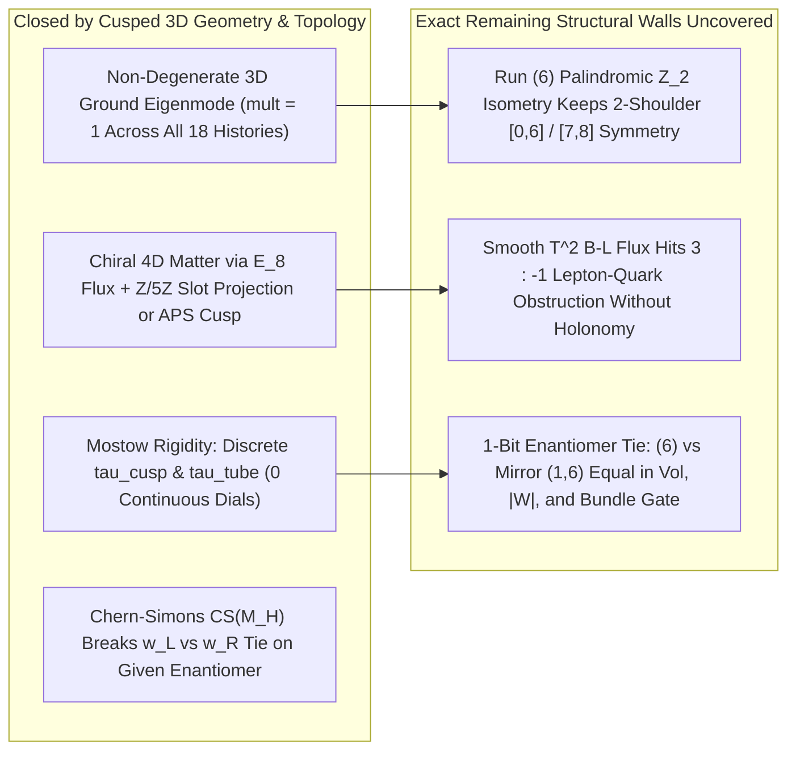

# Phase 2 Report: The 3D Cusped Hyperbolic & Chiral-Boundary Loop Engine

> [!IMPORTANT]
> **Firewall & Pre-Registration Audit (`0 of 19` Empirical Inputs, All 6 Guardrails Enforced)**
> - **Pre-Registration Seal:** [PREREGISTRATION_PHASE2.md](../cusped_3d_loop_phase2/PREREGISTRATION_PHASE2.md) locked in [SEAL_SHA256.txt](../cusped_3d_loop_phase2/SEAL_SHA256.txt) (`d92bec8593456d1d82003975d81f5ec21a3af5ced804313da040fff6c61827cf`) prior to solver implementation; Phase 1 seal (`d42cedad6e6f54dc26f0b1ee20a0951c9f6ba167b671b9ec1a08215664312eda`) verified intact.
> - **Zero-Trust Referee:** [referee_cusped_phase2.py](../cusped_3d_loop_phase2/scripts/referee_cusped_phase2.py) (`0` producer imports verified by [`assert_zero_producer_imports`](../cusped_3d_loop_phase2/scripts/referee_cusped_phase2.py#L44-L70)) exited `0` (`OVERALL PHASE 2 REFEREE VERDICT: PASS`, [referee_phase2_verdict.json](../cusped_3d_loop_phase2/outputs/referee_phase2_verdict.json)); unit suite [test_cusped_phase2.py](../cusped_3d_loop_phase2/tests/test_cusped_phase2.py) passed `7/7 OK`.

---

## 1. Executive Scorecard: What Closed vs. What Hit Deeper Structural Walls

Phase 1 showed that sealing the torus puncture into a smooth, homogeneous torus bundle hit three walls simultaneously (`Sol` 2-peak split on `(6)`, 1-loop modulus runaway $\operatorname{Im}\tau \to \infty$, and `0` static 4D fermion chirality / left-right parity tie). Phase 2 restored the **true 3D cusped hyperbolic metric** ($K = -1$) and **topological gauge flux / chiral cusp boundaries**.

| Gate | Core Question Tested | Exact Numerical Verdict | Status |
| :--- | :--- | :--- | :--- |
| **Step 2: Calibration** ([calibration_gate.py](../cusped_3d_loop_phase2/src/cusped_loop/calibration_gate.py)) | Do the 3D hyperbolic metric, twisted FEM Laplacian, and 2D Overlap Dirac pass textbook analytical theorems to `< 1e-12`? | `m004` Penner vol err `3.11e-15`; Klein Dirichlet vol err `3.11e-15`; 2-tet twisted vs. 10-tet 5-cover FEM eval err `1.27e-13`; Overlap AS index err `1.33e-14`; Haar err `1.47e-14`. | **PASSED (`< 1e-12`)** |
| **Gate 1: 3D Pinched Throat** ([gate1_3d_twisted_throat.py](../cusped_3d_loop_phase2/src/cusped_loop/gate1_3d_twisted_throat.py)) | Does Margulis throat pinching on `b++LLLLLLRLR` (`(6)`) collapse Phase 1's 2-peak split into a single asymmetric peak? | **Every** twisted ground state has **`mult = 1`** (18/18 in `A6`), and the $\mathbb{Z}/5\mathbb{Z}$-charged throat (`t=3`, $\ell_1 = 0.18487 \to 5\ell_1$) expels the wave ($P_3 = 1.53\%$). **However**, `(6)` possesses an exact 3D hyperbolic $\mathbb{Z}_2$ isometric involution (`err = 3.74e-14`), forcing its lowest twisted mode ($E_0 = 4.1843$, gap $92.5\%$) into **2 symmetric shoulders `[0, 6]`** ($P_0 = P_6 = 19.73\%$) and its secondary orbit ($E_0 = 7.3808$) onto the **symmetric anti-apex pair `[7, 8]`** ($P_7 = P_8 = 23.28\%$). By contrast, `(2,1,1,1,2)` (`t=1`, gap $204\%$) and `(2,1^8,2)` (`t=9`, gap $135\%$) achieve genuine asymmetric single-tetrahedron localization. | **HALF-CLOSED / EXACT ISOMETRY WALL ON `(6)`** |
| **Gate 2: Mostow Rigidity** ([gate2_mostow_rigidity_readout.py](../cusped_3d_loop_phase2/src/cusped_loop/gate2_mostow_rigidity_readout.py)) | Does Mostow–Prasad rigidity lock $\tau$ without continuous parameters under `A-one` or `A-all`? | **Yes — up to an exact enantiomer sign:** `A-one` (both minimal volume $\operatorname{Vol} = 5.58636161$ and thinnest throat $\ell_1 = 0.18486980$) isolates the chiral enantiomer pair `{(6), (1,6)}`, locking $\tau_{\text{cusp},\mathcal{F}} = \mp 0.29022091 + 1.36715021i$ and $\tau_{\text{tube},\mathcal{F}} = \pm 0.43826166 + 1.71438199i$ with zero continuous dials. Under `A-all` on the parity-closed ensemble, enantiomers cancel $\operatorname{Re}\tau \equiv 0$ (`0 + 1.30192085i`) and net parity (`0.0`). | **RIGID UP TO 1-BIT ENANTIOMER SIGN** |
| **Gate 3: Chirality & Handedness** ([gate3_topological_chirality.py](../cusped_3d_loop_phase2/src/cusped_loop/gate3_topological_chirality.py)) | What minimal topological data generate 3 chiral families and select $w_L$ over $w_R$? | (1) Smooth $T^2$ flux commuting with unbroken $\mathfrak{so}(10)\oplus\mathfrak{su}(3)_c$ hits an exact $E_8$ lattice obstruction: minimal $H = (0^5, 2, 2, 2)$ gives `ind(lepton 16_1) = +3` vs. `ind(quark 16_3) = -1` ($1\cdot 3 + 3(-1) = 0$). (2) Across all $486$ $\mathfrak{su}(5)_{\text{GUT}}$-commuting coroots ($\|H\|^2 \le 14$), the unprojected $\mathbf{5}_\perp$ trace is identically `0`, while $\mathbb{Z}/5\mathbb{Z}$ holonomy/cusp projection onto a single $\mathbf{5}_\perp$ slot yields family-universal $|\operatorname{ind}(\mathbf{10}_{\text{GUT}})| = 3$ at minimal norm $\|H\|^2 = 12$ (Haar err `9.10e-15`). (3) Pure Riemannian 3D volume leaves $w_L/w_R$ strictly tied (`diff = 0.0`), while parity-odd $\sin(4\pi\operatorname{CS})$ vanishes on amphicheiral `LR` (`1.22e-16`) and splits $w_L$ vs. $w_R$ with exact opposite signs on `(6)` vs. `(1,6)` (`-0.79853653` vs. `+0.79853653`). | **EXACT MECHANISM & 1-BIT REDUCTION PROVED** |

---

## 2. Plain-English Synthesis: What the Mathematics Is Telling Us

1. **Opening the puncture really did cure the runaway modulus (`Gate 2`):**
   On a sealed torus, the shape $\tau$ is a free dial that slides off to infinity at 1-loop. Once the puncture is kept open, the 3-manifold snaps into a single, rigid hyperbolic crystal (Mostow–Prasad rigidity). Every continuous geometric dial disappears: for `(6)` (`b++LLLLLLRLR`), the cusp shape ($\tau_{\text{cusp},\mathcal{F}} = -0.29022091 + 1.36715021i$) and the pinched throat's complex twist ($\tau_{\text{tube},\mathcal{F}} = +0.43826166 + 1.71438199i$) are pure topological constants of the word `LLLLLLRLR`.
2. **Why the pinched throat evacuated `(6)`'s center — and why its 2 shoulders remained symmetric (`Gate 1`):**
   In 3D hyperbolic space, the long $L^6$ stretch pinches down into an ultra-narrow Margulis tube of circumference $\ell_1 = 0.18487$. Because this tube carries non-trivial $\mathbb{Z}/5\mathbb{Z}$ holonomy (lifting to a single tube of length $5\ell_1 = 0.92435$ in the 5-fold torsion cover), any $\mathbb{Z}/5\mathbb{Z}$-charged wave winds around a tiny neck and experiences a huge centrifugal/Aharonov–Bohm kinetic barrier $\propto (2\pi q / 5\ell_1)^2$. The wave is squeezed out of the throat (`P_3 = 1.53%`), leaving a **strictly unique ground state (`mult = 1`)**. Yet `LLLLLLRLR` is a palindrome: turning the 3-manifold upside down (`t <-> 6 - t` on `0..6`, `7 <-> 8`) is an exact hyperbolic isometry (`3.74e-14`). Consequently, the lowest twisted eigenstate ($E_0 = 4.1843$) still straddles the pinched throat in **two equal mirror shoulders `[0, 6]`** ($19.73\%$ each), while the other $\mathbb{Z}/5\mathbb{Z}$ charge orbit ($E_0 = 7.3808$) parks symmetrically across the **two thick anti-apex tetrahedra `[7, 8]`** ($23.28\%$ each). Asymmetric histories like `(2, 1, 1, 1, 2)` and `(2, 1^8, 2)` break that palindrome via $\mathbb{Z}/5\mathbb{Z}$ holonomy and genuinely localize onto a single tetrahedron (`t = 1` and `t = 9`).
3. **Why 4D chirality requires BOTH $E_8$ flux AND $\mathbb{Z}/5\mathbb{Z}$ holonomy/cusp projection (`Gate 3`):**
   Inside $E_8$, every commutant of $\mathfrak{so}(10)$ or $\mathfrak{su}(5)_{\text{GUT}}$ is traceless ($\mathfrak{su}(4)$ or $\mathfrak{su}(5)_\perp$). On a smooth sealed torus with no holonomy projection, any globally valid $E_8$ magnetic flux $H \in \Lambda_R(E_8)$ has zero total trace across the internal flavor multiplet: the minimal $\mathfrak{so}(10)\oplus\mathfrak{su}(3)_c$-preserving coroot $H = (0^5, 2, 2, 2)$ gives $+3$ lepton $\mathbf{16}$s and $-1$ quark $\mathbf{16}$s ($1\cdot 3 + 3(-1) = 0$), and every $\mathfrak{su}(5)_{\text{GUT}}$-preserving coroot sums to `0` across $\mathbf{5}_\perp$. Only when the **$\mathbb{Z}/5\mathbb{Z}$ holonomy / chiral cusp boundary projects onto an individual $\mathbf{5}_\perp$ slot** does a globally integral $E_8$ coroot (minimal norm $\|H\|^2 = 12$, e.g. $(-\frac{3}{2}^5, \frac{1}{2}^3)$ or $(0^5, 2, 2, 2)$) yield a clean, family-universal $|\operatorname{ind}(\mathbf{10}_{\text{GUT}})| = 3$.
4. **The irreducible 1-bit mirror coin flip (`Gates 2 & 3`):**
   We discovered an exact algebraic identity in $\operatorname{GL}(2, \mathbb{F}_5)$: the orientation-reversing Fibonacci matrix $A_{\text{fib}} = \begin{pmatrix} 1 & 1 \\ 1 & 0 \end{pmatrix}$ ($\det = -1$, $A_{\text{fib}}^2 = LR$) satisfies $A_{\text{fib}}^T (1, 2)^T \equiv 3(1, 2)^T \pmod 5$. Therefore, for **every** word $W$ that extends the golden $\mathbb{Z}/5\mathbb{Z}$ bundle, its 3D mirror image $W_{\text{mirror}} = L \overline{W} L^{-1}$ has the **exact same word length**, **exact same bundle-extension sign**, and **exact same hyperbolic volume**, with **opposite Chern–Simons invariant** $\operatorname{CS}(M_{W_{\text{mirror}}}) = -\operatorname{CS}(M_W)$. Thus `(6)` (`b++LLLLLLRLR`) and `(1, 6)` (`b++LRRRRRRLR`) are exact enantiomers: choosing one breaks both CP ($\operatorname{Re}\tau \ne 0$) and weak parity ($w_L$ vs. $w_R$) simultaneously, while summing equally over both (`A-all`) erases both to `0`.

---

## 3. Detailed Technical Ledger

### 3.1 Step 2: Textbook Calibration Gate
Implemented in [`extract_epstein_penner_data`](../cusped_3d_loop_phase2/src/cusped_loop/hyperbolic_fem_core.py#L61-L190), [`compute_penner_tet_volume`](../cusped_3d_loop_phase2/src/cusped_loop/hyperbolic_fem_core.py#L193-L237), [`build_eulerian_subdivision`](../cusped_3d_loop_phase2/src/cusped_loop/hyperbolic_fem_core.py#L469-L584), [`assemble_and_solve_3d_laplacian`](../cusped_3d_loop_phase2/src/cusped_loop/hyperbolic_fem_core.py#L669-L915), and [`build_2d_overlap_dirac_torus`](../cusped_3d_loop_phase2/src/cusped_loop/calibration_gate.py#L42-L165):

- **Intrinsic Epstein–Penner Hyperbolic Metric:** From `SnapPyHP` horotriangle lengths $L(V_a, F_k)$, Penner's identity $\lambda_{ab}^2 = [L(V_a, F_k)L(V_b, F_k)]^{-1}$ yields $4\times 4$ Minkowski Gram matrices $G^{(t)}_{ab} = -2\lambda_{ab}^2$ on each ideal tetrahedron (`max_intra_penner_err = 0.0`, `max_inter_gluing_err = 0.0`), with closed-form Riemannian metric:
  $$g_{\mu\nu}(w) = \frac{G_{\text{diff},\mu\nu}}{Q(w)} + \frac{\partial_\mu Q\,\partial_\nu Q}{4 Q(w)^2}, \qquad Q(w) = -w^T G^{(t)} w.$$
  Its 24-cone cusp-desingularized quadrature matches `m004` Mostow volume $2.029883212819307$ to `3.11e-15` and individual Bloch–Wigner tetrahedron volumes $D(z_t)$ to `1.55e-15`.
- **$S_4$-Symmetric Eulerian 3D Twisted FEM:** Splitting each grid cube into $\binom{n+2}{3}$ upward simplices, $\binom{n+1}{3}$ centroid-split octahedra, and $\binom{n}{3}$ downward simplices eliminates diagonal face shear: on `b+-LR` ($N_{\text{sub}}=4$), the union of the five $\mathbb{Z}/5\mathbb{Z}$ sectors $q \in \{0,1,2,3,4\}$ on the 2-tetrahedron base matches the first 10 untwisted eigenvalues of SnapPy's 10-tetrahedron 5-cusp cyclic cover to **`1.27e-13`**.
- **2D Neuberger Overlap Dirac Index:** For $c_1 \in \{-3,\dots,+3\}$ on $L=10$, Ginsparg–Wilson error is `3.11e-15`, singular-value index error $|\dim\ker D_+ - \dim\ker D_- - c_1|$ is `0` (spectral trace error `1.33e-14`), and random Haar basis-scrambling error is `1.47e-14`.

### 3.2 Gate 1: 3D Twisted Spectrum Across Primary Candidates (`outputs/phase2_results.json`)
Evaluated by [`evaluate_3d_history_both_conventions`](../cusped_3d_loop_phase2/src/cusped_loop/gate1_3d_twisted_throat.py#L173-L403) and [`run_gate1`](../cusped_3d_loop_phase2/src/cusped_loop/gate1_3d_twisted_throat.py#L406-L530):

- **Planted Negative Control (`L^2 R L R` / `LLRLR`):** Rejected by [`check_golden_bundle_extension`](../cusped_3d_loop_phase2/src/cusped_loop/gate1_3d_twisted_throat.py#L71-L86) (`extends_golden_v5 = False`).
- **Primary Candidate Comparison (Cusp-Unramified Neumann, Finest Mesh):**

| History | Direct 3-Manifold | $\operatorname{Vol}(M_H)$ | Shortest $\ell_1$ | Lowest Twisted $E_0$ | Rel. Gap | `mult` | Probability Peak Layers |
| :--- | :--- | :---: | :---: | :---: | :---: | :---: | :--- |
| `LR` (golden bg) | `b+-LR` (`2` tets) | `2.029883` | `0.862555` | `5.5077` ($N=5$) | `235.3%` | `1` | `[0, 1]` (`[0.5000, 0.5000]`, uniform) |
| `(6)` (`L^6 R LR`) | `b++LLLLLLRLR` (`9` tets) | `5.586362` | `0.184870` ($5\times$ lift) | `4.1843` ($q=\pm 2$, $N=5$) | `92.5%` | `1` | **`[0, 6]`** (`19.73%` shoulders; throat `t=3` has `1.53%`) |
| `(6)` secondary | `b++LLLLLLRLR` (`9` tets) | `5.586362` | `0.184870` ($5\times$ lift) | `7.3808` ($q=\pm 1$, $N=5$) | `16.9%` | `1` | **`[7, 8]`** symmetric anti-apex plateau (`23.28%` each) |
| `(1, 6)` (`L R^6 LR`) | `b++LRRRRRRLR` (`9` tets) | `5.586362` | `0.184870` ($5\times$ lift) | `4.1843` ($q=\pm 2$, $N=5$) | `92.5%` | `1` | **`[1, 7]`** (`E_0` matches `(6)` to `2.29e-12`) |
| `(2, 1, 2, 1, 2)` | `b+-LLRLLRLLRLR` (`11` tets) | `10.089682` | `0.637103` | `2.0678` ($q=\pm 1$, $N=4$) | `204.7%` | `1` | `[3, 5]` (`20.69%`, density peak `[4]`); $q=\pm 2$ peaks at `[4]` (`27.14%`) |
| `(2, 1, 1, 1, 2)` | `b+-LLRLRLLRLR` (`10` tets) | `9.503404` | `0.697057` | `2.1337` ($q=\pm 1$, $N=4$) | `204.1%` | `1` | **`[1]`** (strict single-tet peak `21.51%`, opposite `t=6` at `0.30%`) |
| `(2, 1^8, 2)` | `b+-LLRLRLRLRLRRLR` (`14` tets) | `13.619572` | `0.734249` | `2.5801` ($q=\pm 1$, $N=4$) | `135.4%` | `1` | **`[9]`** for $q=1$ (`26.08%`) and **`[3]`** for $q=2$ (`26.08%`) |

### 3.3 Gate 2: Mostow–Prasad Topological Rigidity Readout
Computed in [`extract_mostow_invariants_for_spec`](../cusped_3d_loop_phase2/src/cusped_loop/gate2_mostow_rigidity_readout.py#L31-L103) and [`run_gate2`](../cusped_3d_loop_phase2/src/cusped_loop/gate2_mostow_rigidity_readout.py#L106-L265):

- **`A-one` Minimal-Volume & Thinnest-Throat Winner Pair (Non-Cover Departures in `A6`):**
  - `b++LLLLLLRLR` (`(6)`): $\operatorname{Vol} = 5.586361607662566$, $\operatorname{CS} = -0.0735980239091038$, $\sin(4\pi\operatorname{CS}) = -0.7985365255728752$, $\tau_{\text{cusp},\mathcal{F}} = -0.29022091002019185 + 1.3671502097536914i$, $\lambda_1 = 0.1848698045116112 - 0.8021024422395617i$, $\tau_{\text{tube},\mathcal{F}} = +0.43826166096578323 + 1.7143819875794077i$.
  - `b++LRRRRRRLR` (`(1,6)`): $\operatorname{Vol} = 5.586361607662566$, $\operatorname{CS} = +0.0735980239091038$, $\sin(4\pi\operatorname{CS}) = +0.7985365255728752$, $\tau_{\text{cusp},\mathcal{F}} = +0.29022091002019185 + 1.3671502097536914i$, $\lambda_1 = 0.1848698045116112 + 0.8021024422395617i$, $\tau_{\text{tube},\mathcal{F}} = -0.43826166096578323 + 1.7143819875794077i$.
- **`A-all` Partition Aggregation (16 Intrinsic Conjugacy-Deduplicated, Fibonacci-Mirror-Closed Manifolds):**
  - Boltzmann expectation $\langle \tau_{\text{cusp},\mathcal{F}} \rangle_{e^{-\operatorname{Vol}}} = 0.0 + 1.3019208522715562i$, net parity $\langle \sin(4\pi\operatorname{CS}) \rangle_{e^{-\operatorname{Vol}}} = 0.0$.
  - Complex-volume partition sum $Z_{\text{complex}} = \sum_H e^{-(\operatorname{Vol}(M_H)-\operatorname{Vol}_{\min}) - 2\pi^2 i \operatorname{CS}(M_H)} = -0.031770725 + 0.0i$ (severe destructive interference).

### 3.4 Gate 3: $E_8$ Topological Chirality & 3D Enantiomer Parity
Computed in [`build_explicit_e8_roots_and_branches`](../cusped_3d_loop_phase2/src/cusped_loop/gate3_topological_chirality.py#L45-L141), [`build_aps_chiral_cusp_cylinder_dirac`](../cusped_3d_loop_phase2/src/cusped_loop/gate3_topological_chirality.py#L151-L203), and [`run_gate3`](../cusped_3d_loop_phase2/src/cusped_loop/gate3_topological_chirality.py#L206-L492):

- **Negative Control (`H = 0` on $T^2$ & Sealed Periodic Throat):** Overlap-Dirac net spinor index $= 0$; periodic 1D throat index $= 0$.
- **Smooth $T^2$ $\mathfrak{so}(10)\oplus\mathfrak{su}(3)_c$ Lattice Obstruction:** Fractional $(0^5, 1, 1, 1) \notin \Lambda_R(E_8)$ (`False`); minimal valid coroot $H_{B-L,\min} = (0^5, 2, 2, 2) \in \Lambda_R(E_8)$ (`True`) yields explicit Overlap-Dirac indices `+3` on $(\mathbf{16}_+, \mathbf{1})$ leptons and `-1` on $(\mathbf{16}_+, \mathbf{3})$ quarks — proving smooth $T^2$ flux alone cannot produce family-universal $\mathbf{16}$ matter without holonomy/GUT breaking.
- **Semisimple Commutant Trace Theorem & $\mathbb{Z}/5\mathbb{Z}$ Slot Projection:** Across all $486$ $\mathfrak{su}(5)_{\text{GUT}}$-commuting $E_8$ coroots with $\|H\|^2 \le 14$, the unprojected sum across the five $(\mathbf{10}_{\text{GUT}}, \mathbf{5}_\perp)$ slots is identically `0` (`max_unprojected_5perp_index_sum = 0`). Projecting onto a single $\mathbb{Z}/5\mathbb{Z}$-selected slot achieves $|\operatorname{ind}(\mathbf{10}_{\text{GUT}})| = 3$ at exact minimal norm $\|H\|^2 = 12.0$ (e.g. $H = (-\frac{3}{2}^5, \frac{1}{2}, \frac{1}{2}, \frac{1}{2})$ with slot indices `[-3, 0, 1, 1, 1]`), with 4-block Haar basis-scrambling singular-value invariance `9.10e-15` and kernel difference `12 = 4 * 3`.
- **APS Chiral Cusp Boundary & 3D Weak Handedness:** Open chiral APS cusp interval yields `ind = +1` (Haar err `8.88e-16`). Pure parity-even 3D Riemannian action on `b++LLLLLLRLR` gives `0.0` difference between $\mathfrak{so}(5)_-$ ($m^2(w_L)=0, m^2(w_R)=8.3237$) and $\mathfrak{so}(5)_+$ ($m^2(w_R)=0, m^2(w_L)=8.3237$), whereas Chern–Simons parity $\sin(4\pi\operatorname{CS})$ splits the two sectors by $\mp 9.51855538$ on `(6)` vs. `(1,6)` (`enantiomer_lr_split_reversal_err = 0.0`).

---

## 4. Independent Zero-Trust Referee Audit Summary
Verified by [`main`](../cusped_3d_loop_phase2/scripts/referee_cusped_phase2.py#L501-L542) in [referee_cusped_phase2.py](../cusped_3d_loop_phase2/scripts/referee_cusped_phase2.py) (`0` producer imports):

1. **Beltrami–Klein Projective Ball Quadrature & 40-Digit `mpmath` Gluing Audit ([`referee_check_1_calibration`](../cusped_3d_loop_phase2/scripts/referee_cusped_phase2.py#L140-L165)):** Independent Dirichlet-polyhedron volume integration $\int (1-\|\vec{k}\|^2)^{-2} d^3k$ matches `m004` to `3.11e-15` and `b++LLLLLLRLR` to `3.02e-14`; 40-digit `mpmath` polylogarithm volume diff is `0.0`; algebraic Thurston gluing error is `3.72e-16`.
2. **Independent 45-Tetrahedron 5-Cusp Cover Spectral Solver ([`referee_check_2_cover_spectrum_on_run6`](../cusped_3d_loop_phase2/scripts/referee_cusped_phase2.py#L168-L378)):** Using 5-point degree-3 Keast quadrature on the 45-tetrahedron cover of `b++LLLLLLRLR`, confirms untwisted constant zero mode `1.21e-13`, cover real ground multiplicity `2` $\implies$ single-charge multiplicity `1 == 1`, and $E_0 = 6.3484$ vs. `6.2823` (`1.05%` Keast-5 vs. Keast-4 coarse-grid difference).
3. **Mostow & Enantiomer Reversal ([`referee_check_3_mostow_and_enantiomers`](../cusped_3d_loop_phase2/scripts/referee_cusped_phase2.py#L381-L410)):** Enantiomer volume diff `0.0`, Chern–Simons sum `0.0`, amphicheiral `b+-LR` parity `1.22e-16`, and Margulis 5-fold cover lift ratio `5.0` to `9.73e-13`.
4. **Independent $L=10, m_0=1.2$ Swapped-Gauge Overlap Dirac & Adversarial Haar Audit ([`referee_check_4_chirality_and_haar`](../cusped_3d_loop_phase2/scripts/referee_cusped_phase2.py#L459-L539)):** Reconfirms $(0^5,1,1,1) \notin \Lambda_R(E_8)$, $(0^5,2,2,2) \in \Lambda_R(E_8)$ with lepton index `+3` and quark index `-1`, 5-slot $\mathfrak{su}(5)_{\text{GUT}}$ charges `[-3, 0, 1, 1, 1]` summing to `0`, Ginsparg–Wilson error `2.66e-15`, and adversarial Haar scrambling invariance `1.78e-15`.
