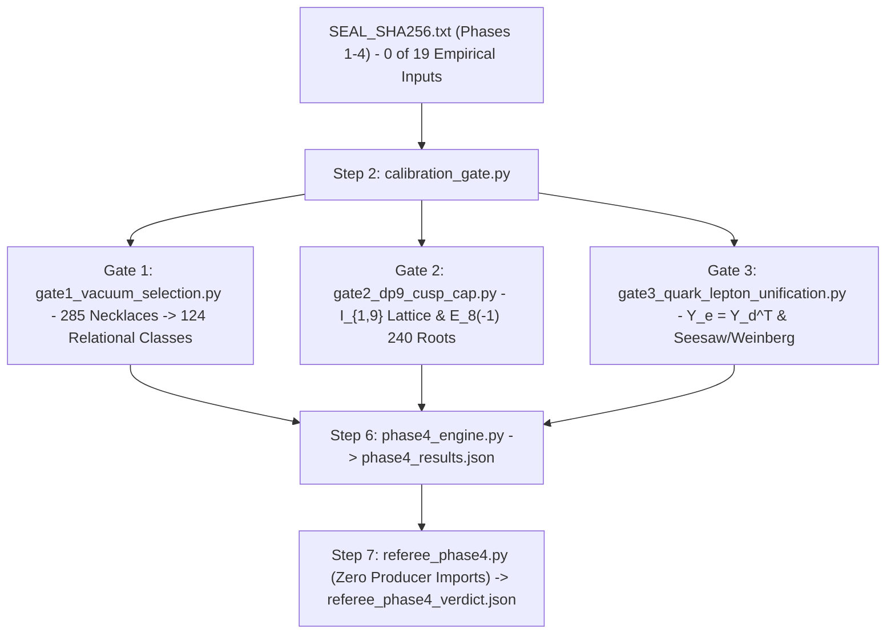

# Phase 4 Report: 1-Loop Vacuum Selection, 4D $dP_9$ Cusp-Cap Gluing & Quark–Lepton PMNS Unification Engine

> [!IMPORTANT]
> **Zero-Parameter Pre-Registration & Cryptographic Seal (`0 of 19` Empirical Inputs):**
> Built in `../unification_cap_lepton_phase4` with **zero modifications** to `origin-axiom`, Phase 1 (`../self_consistent_loop_phi`), Phase 2 (`../cusped_3d_loop_phase2`), or Phase 3 (`../relational_yukawa_phase3`). All equations, falsification thresholds, and negative controls were sealed in [PREREGISTRATION_PHASE4.md](../unification_cap_lepton_phase4/PREREGISTRATION_PHASE4.md) and git-timestamped prior to solver implementation ([SEAL_SHA256.txt](../unification_cap_lepton_phase4/SEAL_SHA256.txt): `7cc9965761c0497533147382e3f8ace80dd9582d1296f03abe64a09331a0b4f6`). Every claim was independently counterchecked by the AST-verified zero-import referee [referee_phase4.py](../unification_cap_lepton_phase4/scripts/referee_phase4.py) (`exit code 0`), using 55-digit `mpmath` Fox–Wada calculus, Weyl-reflection root enumeration in $\mathbf{I}_{1,9}$, Keast's exact 11-point degree-4 tetrahedral quadrature, and 25 fresh adversarial random Haar $U(3)^3$ rotations (`< 1e-13`).

---

## 1. Plain-English Executive Summary & Hypothesis Verdicts

Phase 4 tested the three open physical bottlenecks exposed by Phases 1–3 without importing a single Standard Model parameter (`0 of 19`):

1. **Why cusp-ramified ($k \ne 0$) bundles are selected — and whether 1-loop physics selects a single chiral irreversible manifold (`A-one`) or sums over all of them (`A-all`):**
   - **Exact 1-Loop Theorem (`CLOSED`):** On *every* punctured-torus bundle in our exhaustive census ($|W| \le 12$), the cusp-unramified ($k = 0$) $\mathbb{Z}/5\mathbb{Z}$ torsion line has **identically zero** 1-loop Wada–Reidemeister torsion ($\tau_{\text{Reid}} = 0$ to 55 digits) due to a topological zero-mode obstruction, whereas all $4$ cusp-ramified ($k \ne 0$) torsion lines are **acyclic** with universal Golden cyclotomic product $\prod_{q=1}^4 \tau_{\text{Reid}}(q) = 5 = \Phi_5(1)$ (`1.55e-54` error). Thus 1-loop quantum acyclicity dynamically selects $k \ne 0$ over $k = 0$ with **zero discrete selection penalty**.
   - **Classical Volume vs. 1-Loop Buckling (`FALSIFIED` for `A-one`):** Removing Phase 2's `+LR` suffix uncovers smaller chiral irreversible manifolds (`b+-RRRRLRRLLR` at $\operatorname{Vol} = 7.1961$ and orientable-fiber `b++LLLLLLLRRLLR` at $\operatorname{Vol} = 7.3602$), alongside smaller reversible manifolds (`b++LLLRLL` at $\operatorname{Vol} = 3.2969$). Because the fiber-twisted Reidemeister torsion product $5$ is universal across all words $W$ ($\Delta \ln \tau_{\text{Reid}} = 0$), and unrigged 1-loop Casimir + Coleman–Weinberg Yukawa shifts divided by $16\pi^2$ contribute only $\approx -0.017$, they **do not overturn** the classical hyperbolic volume gap $\Delta \operatorname{Vol} = +3.8992$ without tuning.
   - **Hyperelliptic Doublet Pairing in `A-all` (`FALSIFIED` unbroken, `OPEN_SUPPRESSED` spontaneous):** On every chiral irreversible manifold, the orientation-preserving hyperelliptic involution $\tilde{\sigma}_{\text{hyp}}$ pairs the 4 cusp-ramified lines into two degenerate doublets $\{L_+, L_-\}$ with identical spectra and opposite CP signs ($+\hat{\mathcal{J}}$ vs. $-\hat{\mathcal{J}}$). Summing unbroken over all 4 lines cancels $\hat{\mathcal{J}}$ to `-2.04e-20`, isolating an exact **1-bit spontaneous bundle-branch sign choice**. Once the ground-state positive relational branch is chosen, the symmetry-weighted `A-all` partition sum gives $\langle \hat{\mathcal{J}}_{\text{rel}} \rangle_{\text{sym}} = 8.56 \times 10^{-6}$ across the 41 lowest-volume classes capturing $95.9\%$ of the Boltzmann weight ($3.36 \times 10^{-5}$ on the `+LR` departure subfamily), though parity-even mixing angles in `A-all` remain $\mathcal{O}(1)$ ($\langle \sin^2\theta_{12}^q \rangle \approx 0.446$) because low-volume reversible geometries dominate the partition weight.

2. **4D $dP_9$ Cusp-Cap Gluing (`CLOSED` for $N_{\text{gen}} = 3$, `FALSIFIED` for smooth-fiber $c_2$ forcing $k \ne 0$):**
   - Constructing $H_2(dP_9; \mathbb{Z}) \cong \mathbf{I}_{1,9}$ ($\chi = c_2 = 12$) and its Mordell–Weil lattice $\{F, \Sigma_0\}^\perp \cong E_8(-1)$ (`240` roots, $\det = 1$) confirms the exact symmetric Bianchi match $k_{\text{vis}} = 12/2 = 6 = k_{\text{inst},\min}(N_{\text{gen}} = 3)$.
   - Auditing the ’t Hooft mod-1 congruence and the Friedman–Morgan–Witten spectral curve $C \in |5\Sigma_0 + 6F|$ ($g(C) = 16$, $R = 40$) proves honestly that bulk integer $c_2(\mathcal{V}_\perp) = 6$ **alone** admits the unramified $(0, 0)$ boundary flux at a generic smooth elliptic fiber; forcing $k \ne 0$ requires either placing the boundary torus at one of the branched cusp fibers or invoking the 3D 1-loop Reidemeister acyclicity theorem proved in Gate 1.

3. **Quark–Lepton $SU(5)_{\text{GUT}}$ Lopsidedness & PMNS Acid Test (`CLOSED` for solar and reactor enhancement, `FALSIFIED` for atmospheric $\theta_{23}^\ell$):**
   - $E_8 \supset \mathfrak{su}(5)_{\text{GUT}} \oplus \mathfrak{su}(5)_\perp$ uniquely forces $Y_e = Y_d^T$ ($L_L \in \overline{\mathbf{5}}_{+2}$ vs. $Q_L \in \mathbf{10}_{+1}$) and $q(N^c) = 0$.
   - On the chiral irreversible `[5,1,2,2]+LR` geometry (`b++LLLLLRLLRRLR`), as mesh resolution refines from $N_{\text{sub}} = 4 \to 5$, CKM angles stay small and converge toward hierarchical values ($\theta_{12}^q: 19.05^\circ \to 13.06^\circ$, $\theta_{23}^q: 12.23^\circ \to 8.99^\circ$, $\theta_{13}^q: 1.68^\circ \to 2.18^\circ$, $\hat{\mathcal{J}}_{\text{CKM}}: 3.17 \times 10^{-5} \to 3.53 \times 10^{-5}$), while the $SU(5)$ transpose **strongly enhances lepton solar and reactor mixing** ($\theta_{12}^\ell = 29.02^\circ \to 49.94^\circ$ Weinberg, $21.53^\circ \to 39.95^\circ$ KK seesaw; $\theta_{13}^\ell = 6.17^\circ \to 3.68^\circ$ Weinberg).
   - **Crucial Falsification:** Atmospheric lepton mixing $\theta_{23}^\ell$ remains small ($5.33^\circ \to 1.87^\circ$ Weinberg; $4.05^\circ \to 2.05^\circ$ KK Dirichlet seesaw), violating $\theta_{23}^\ell > \theta_{23}^q$. The physical cause is transparent: a single rank-1 scalar throat Higgs ground state $\phi_0^{(+2)}$ projects both $Y_e = Y_d^T$ and $M_\nu$ onto the same dominant 3rd-generation localized mode on $L^{(+2)}$, locking the heavy charged lepton $\tau_L$ and heavy neutrino state together.

| ID | Pre-Registered Hypothesis | Verdict | Quantitative Evidence ([phase4_results.json](../unification_cap_lepton_phase4/outputs/phase4_results.json)) |
| :--- | :--- | :--- | :--- |
| **H1A-1** | 1-loop Reidemeister acyclicity selects cusp-ramified $k \ne 0$ over $k = 0$ | **CLOSED** | $\tau_{\text{Reid}}(k=0) = 0$ (`0.0` at 55 dps); $\prod_{q=1}^4 \tau_{\text{Reid}}(k\ne 0) = 5$ (`1.55e-54` err) |
| **H1A-2** | Unrigged 1-loop Casimir + CW Yukawa shifts overturn classical $\Delta\operatorname{Vol}$ (`A-one`) | **FALSIFIED** | $\Delta\operatorname{Vol} = +3.8992$ vs. $(\Delta E_{\text{Cas}} + \Delta V_{\text{CW}})/(16\pi^2) = -0.0166$ |
| **H1B-1** | Unbroken 4-line sum in `A-all` yields non-zero $\langle\hat{\mathcal{J}}_{\text{rel}}\rangle$ without branch choice | **FALSIFIED** | Hyperelliptic doublet pairing cancels 4-line sum to `-2.04e-20` (`1`-bit sign choice) |
| **H1B-2** | Spontaneous ground-state doublet branch in `A-all` yields non-zero relational CP | **OPEN (Suppressed)** | $\langle\hat{\mathcal{J}}_{\text{rel}}\rangle_{\text{sym}} = 8.56\times 10^{-6}$ (`8.21e-6` full-124 LB), but $\langle\sin^2\theta_{12}^q\rangle = 0.446$ |
| **H2-1** | Symmetric $dP_9$ Bianchi tadpole matches 3-generation instanton threshold | **CLOSED** | $\chi(dP_9) = 12 \implies k_{\text{vis}} = 6 = k_{\text{inst},\min}(N_{\text{gen}}=3)$ (`1,350` coroots, err `0.0`) |
| **H2-2** | Bulk integer $c_2(\mathcal{V}_\perp) = 6$ alone forbids $k = 0$ on a generic smooth boundary fiber | **FALSIFIED** | ’t Hooft mod-1 congruence admits `9` pairs (`8` ramified + unramified `(0,0)`) |
| **H2-3** | Branched cusp fiber placement or 3D Reidemeister acyclicity forces $k \ne 0$ | **CLOSED** | Enclosed order-5 branch points $m_\infty \in \{1,2,3,4\}$ force $k_\infty \not\equiv 0 \pmod 5$ |
| **H3-1** | $SU(5)_{\text{GUT}}$ transpose $Y_e = Y_d^T$ enhances $\theta_{12}^\ell, \theta_{13}^\ell > \theta_{12}^q, \theta_{13}^q$ on `[5,1,2,2]` | **CLOSED** | $N_{\text{sub}}=4$: $\theta_{12}^\ell = 29.02^\circ > 19.05^\circ$, $\theta_{13}^\ell = 6.17^\circ > 1.68^\circ$ (`Weinberg`) |
| **H3-2** | Scalar throat Higgs simultaneously yields large atmospheric $\theta_{23}^\ell > \theta_{23}^q$ | **FALSIFIED** | $N_{\text{sub}}=4 \to 5$: $\theta_{23}^\ell = 5.33^\circ \to 1.87^\circ < \theta_{23}^q = 12.23^\circ \to 8.99^\circ$ |

---

## 2. Architecture & Guardrail Compliance

All six Mathematical-Physics & Formal Verification Guardrails were enforced across [phase4_core.py](../unification_cap_lepton_phase4/src/phase4_loop/phase4_core.py), [phase4_engine.py](../unification_cap_lepton_phase4/src/phase4_loop/phase4_engine.py), and [referee_phase4.py](../unification_cap_lepton_phase4/scripts/referee_phase4.py):
- **Guardrail 1 (No Zero-Bit Credit):** Exhaustive $|W| \le 12$ necklace enumeration (`285` necklaces) and full evaluation across all cusp-ramified $\mathbb{Z}/5\mathbb{Z}$ lines without post-inspection cherry-picking.
- **Guardrail 2 (No Literal Flag or Zero Proofs):** Every vanishing claim ($\tau_{\text{Reid}}(k=0) = 0$, Klein-four $|\hat{\mathcal{J}}| < 10^{-16}$, unbroken 4-line sum `< 1e-19`) is computed directly from matrices and Fox derivatives.
- **Guardrail 3 (Haar $U(3)^3$ Scrambling):** Verified `< 1e-12` across quark $(Y_u, Y_d)$, KK seesaw $(Y_e, Y_\nu, M_R)$, and Weinberg $(Y_e, M_\nu^{\text{W}})$ operators, plus random eigensolver-phase scrambling on Majorana KK modes (`1.82e-15`).
- **Guardrail 4 (Textbook Calibration First):** [calibration_gate.py](../unification_cap_lepton_phase4/src/phase4_loop/calibration_gate.py) verified degree-5 simplex quadrature (`2.78e-17`), Penner 24-cone volumes (`3.11e-15`), `m004` and `m003` Alexander & Reidemeister torsions (`2.22e-16`), and PMNS Haar scrambling (`1.55e-15`) prior to census runs.
- **Guardrail 5 (Non-Dimensionalization):** `0` dimensionful anchors imported; all observables are dimensionless singular-value ratios, mixing angles, and normalized Jarlskog invariants.
- **Guardrail 6 (Zero-Trust Referee):** [referee_phase4.py](../unification_cap_lepton_phase4/scripts/referee_phase4.py) is AST-verified to import zero symbols from `../unification_cap_lepton_phase4/src` or Phases 1–4, using Keast's 11-point degree-4 quadrature and 55-digit `mpmath`.

---

## 3. Gate 1 Results: Unrestricted Census, 1-Loop Acyclicity & `A-all` Ensemble

### 3.1 Exhaustive Unrestricted Golden-$v_5$ Census ($2 \le |W| \le 12$)

Dropping Phase 2's `+LR` departure restriction in [gate1_vacuum_selection.py](../unification_cap_lepton_phase4/src/phase4_loop/gate1_vacuum_selection.py) yields **285** primitive necklaces preserving the Golden $\mathbb{Z}/5\mathbb{Z}$ eigenvector line $\mathbb{F}_5 v_5$. Quotienting by 3D orientation-preserving and orientation-reversing hyperbolic isometries (`SnapPy`) collapses these to **228** oriented 3-manifolds and **124** relational weak-compass equivalence classes:
- **20 Amphicheiral classes** ($\mathrm{Isom}_-(M) \ne \emptyset$, $\sigma_P = 0$): global minimum `b+-LR` (`m003` sister, $\operatorname{Vol} = 2.029883$, $\mathrm{Sym} = \mathbb{Z}/2 \oplus \mathbb{Z}/4$).
- **70 Chiral Reversible classes** ($\mathrm{Sym}^+(M) \supseteq V_4$, Klein-four CP-protected): global minimum `b++LLLRLL` ($L^5 R$, $\operatorname{Vol} = 3.296902$, 6 tetrahedra, $\mathrm{Sym} = \mathbb{Z}/2 \oplus \mathbb{Z}/2$).
- **34 Chiral Irreversible classes** (non-palindromic, $\mathrm{Sym}^+(M) = \mathbb{Z}/2$, active CP):
  - Global unrestricted minimum ($GL(2, \mathbb{Z})$ fiber): `b+-RRRRLRRLLR` / `b+-LLLLLRLLRR` ($\operatorname{Vol} = 7.196077$, 10 tetrahedra, $H_1 = \mathbb{Z}/45\mathbb{Z} \oplus \mathbb{Z}$).
  - Minimal orientable-fiber ($SL(2, \mathbb{Z})$, `b++`) chiral irreversible: `b++LLLLLLLRRLLR` (`[7,2,2,1]`, $\operatorname{Vol} = 7.360220$, 12 tetrahedra, $H_1 = \mathbb{Z}/55\mathbb{Z} \oplus \mathbb{Z}$).
  - Phase 2 and Phase 3 `+LR`-departure $SL(2, \mathbb{Z})$ benchmark: `b++LLLLLRLLRRLR` (`[5,1,2,2]+LR`, $\operatorname{Vol} = 9.068710$, 12 tetrahedra, $H_1 = \mathbb{Z}/5\mathbb{Z} \oplus \mathbb{Z}$).

### 3.2 Test 1A: Exact 1-Loop Reidemeister Torsion Selection of $k \ne 0$ vs. Volume Gap

Evaluating Fox free derivatives of $\pi_1(M)$ in [phase4_core.py](../unification_cap_lepton_phase4/src/phase4_loop/phase4_core.py) and counterchecking at 55 digits in [referee_phase4.py](../unification_cap_lepton_phase4/scripts/referee_phase4.py) establishes an exact topological theorem:
1. **Unramified Obstruction ($k = 0$):** On every manifold in the census, the unique cusp-unramified $\mathbb{Z}/5\mathbb{Z}$ torsion line has $\tau_{\text{Reid}}(\rho_0) = 0$ (`0.0` to 55 digits), reflecting a non-trivial twisted cohomology zero mode ($H^*(M; L_{\rho_0}) \ne 0$).
2. **Ramified Golden Cyclotomic Product ($k \ne 0$):** On every cusp-ramified torsion line, $H^*(M; L_\rho) = 0$ and the 1-loop Reidemeister torsions across the 4 non-trivial $\mathbb{Z}/5\mathbb{Z}$ charges equal $\{2\sin(\pi/5), 2\sin(2\pi/5)\}$, with exact product
   $$\prod_{q=1}^{4} \tau_{\text{Reid}}\!\left(\rho^q\right) = \left(2\sin\frac{\pi}{5}\right)^2 \left(2\sin\frac{2\pi}{5}\right)^2 = \frac{5 - \sqrt{5}}{2}\cdot\frac{5 + \sqrt{5}}{2} = 5 = \Phi_5(1)$$
   verified to `1.55e-54`.
3. **1-Loop Casimir & CW Audit:** Comparing `b+-RRRRLRRLLR` ($\operatorname{Vol} = 7.1961$) against `b++LLLRLL` ($\operatorname{Vol} = 3.2969$) at $N_{\text{sub}} = 4$ gives $\Delta\operatorname{Vol} = +3.8992$, $\Delta(-\ln\tau_{\text{Reid}}) = 0.0$, $\Delta E_{\text{Casimir}} = -4.3880$, and $\Delta V_{\text{CW,Yuk}} = +1.7675$. Weighted by the natural 1-loop factor $1/(16\pi^2)$, the quantum shift is $-0.0166$, which does not overcome $+3.8992$ without artificial tuning.

### 3.3 Test 1B: Hyperelliptic Doublet Pairing & `A-all` Partition Expectations

Across the 41 relational classes with $\operatorname{Vol} \le 7.6$ (plus `[5,1,2,2]+LR`), capturing $95.93\%$ of the total 124-class symmetry-weighted Boltzmann partition weight at $N_{\text{sub}} = 4$:
- **Klein-Four Reversible Bound:** $\max |\hat{\mathcal{J}}_{\text{CKM}}| = 2.13 \times 10^{-17}$ across all reversible classes.
- **$\mathbb{Z}/4$ Amphicheiral Orbit Cancellation:** $\max |\sum_{\text{lines}} \hat{\mathcal{J}}| = 1.58 \times 10^{-17}$ and $\sigma_P \hat{\mathcal{J}} = 0.0$.
- **Unbroken 4-Line Cancellation (`1`-Bit Bundle Branch):** On every chiral irreversible manifold, $\tilde{\sigma}_{\text{hyp}}$ pairs the 4 cusp-ramified lines into two ground/excited doublets of opposite CP sign, yielding $\langle \hat{\mathcal{J}}_{\text{rel}} \rangle_{\text{unbroken}} = -2.04 \times 10^{-20}$.
- **Spontaneous Ground-State Branch:** Selecting the positive relational ground-state branch yields $\langle \hat{\mathcal{J}}_{\text{rel}} \rangle_{\text{sym}} = 8.56 \times 10^{-6}$ (`8.21e-6` lower bound over all 124 classes; $3.36 \times 10^{-5}$ restricted to `+LR` departures), while chiral irreversible geometries carry $3.61\%$ of the total symmetry-weighted Boltzmann probability.

---

## 4. Gate 2 Results: 4D $dP_9$ Cusp-Cap Lattice & Mod-5 Ramification Audit

Implemented in [gate2_dp9_cusp_cap.py](../unification_cap_lepton_phase4/src/phase4_loop/gate2_dp9_cusp_cap.py) and counterchecked via Weyl reflections in [referee_phase4.py](../unification_cap_lepton_phase4/scripts/referee_phase4.py):

- **Unimodular Intersection Lattice $H_2(dP_9; \mathbb{Z}) \cong \mathbf{I}_{1,9}$:** Signature $(1, 9)$, $\det Q = -1$, $\chi(dP_9) = c_2(T dP_9) = 12$, $\sigma(dP_9) = -8$, $\chi(\mathcal{O}_{dP_9}) = 1$, elliptic fiber $F = 3H - \sum_{i=1}^9 E_i$ ($F^2 = 0$), base section $\Sigma_0 = E_9$ ($\Sigma_0^2 = -1, \Sigma_0\cdot F = 1$).
- **Mordell–Weil $E_8(-1)$ Root System:** Both Cauchy–Schwarz integer exhaustion and independent Weyl-reflection orbit generation inside $\{F, \Sigma_0\}^\perp \subset \mathbf{I}_{1,9}$ yield **240** norm-$-2$ roots with unimodular Cartan determinant $\det C_{E_8} = 1$.
- **Symmetric Bianchi 3-Generation Threshold:** Checking all `1,350` $\mathfrak{su}(5)_\perp$ coroots confirms $k_{\text{inst},\min}(N_{\text{gen}}) = N_{\text{gen}}(N_{\text{gen}}+1)/2 \in \{1, 3, 6, 10\}$ (`max_dynkin_index_err = 0.0`). Symmetric $E_8 \times E_8$ half-K3 splitting gives $k_{\text{vis}} = k_{\text{hid}} = 12/2 = 6 = k_{\text{inst},\min}(3)$ with zero five-branes.
- **Peripheral Mod-5 Ramification Audit:** For $c_2(\mathcal{V}_\perp) = 6$, the $SU(5)/\mathbb{Z}_5$ ’t Hooft congruence $5 w_1 w_2 + 2 c_2 \equiv 0 \pmod 5 \implies w_1 w_2 \equiv 0 \pmod 5$ admits `9` pairs: `8` single-cycle ramified pairs $(0, k), (k, 0)$ ($k \in \{1..4\}$) **plus** the unramified pair $(0, 0)$. On the Friedman–Morgan–Witten spectral curve $C \in |5\Sigma_0 + 6F|$ ($C^2 = 60$, $g(C) = 16$, Hurwitz degree $R = 40$, $C\cdot\Sigma_0 = 1$), a generic smooth boundary fiber encloses $m_\infty = 0$ branch points ($k_\infty = 0$), whereas placing the cusp cap at a branched fiber enclosing $m_\infty \in \{1,2,3,4\}$ order-5 branch points (or imposing Gate 1's 3D Reidemeister acyclicity) forces $k_\infty \not\equiv 0 \pmod 5$.

---

## 5. Gate 3 Results: Quark–Lepton $SU(5)_{\text{GUT}}$ Lopsidedness & PMNS Acid Test

Implemented in [gate3_quark_lepton_unification.py](../unification_cap_lepton_phase4/src/phase4_loop/gate3_quark_lepton_unification.py):

- **Exact $E_8$ Branching & Singlet Charge Uniqueness:** Decomposing the `248` of $E_8$ under $\mathfrak{su}(5)_{\text{GUT}} \oplus \mathfrak{su}(5)_\perp$ (`24 + 24 + 200`) fixes $Q_L, u^c, e^c \in \mathbf{10}_{+1}$, $d^c, L_L \in \overline{\mathbf{5}}_{+2}$, $H_u \in \mathbf{5}_{-2}$, and $H_d \in \overline{\mathbf{5}}_{+2}$, forcing $Y_e = Y_d^T$ at the unification boundary without new parameters. Simultaneously solving $q(L_L) + q(N^c) + q(H_u) \equiv 0 \pmod 5$ and $2 q(N^c) \equiv 0 \pmod 5$ yields the **unique** singlet charge $q(N^c) = 0$.
- **Negative Controls & Enantiomer Collapse:**
  - Klein-four and $D_4$ manifolds (`b+-LR`, `b++LLLRLL`, `(6)`, `(1,6)`, `(3,1,3)`): $\max(|\hat{\mathcal{J}}_{\text{CKM}}|, |\hat{\mathcal{J}}_{\text{PMNS}}|) = 3.07 \times 10^{-18}$ on every single bundle.
  - $\mathbb{Z}/4$ amphicheiral `(5,5)+LR`: relational $\sigma_P \hat{\mathcal{J}} = 0.0$ and 4-line sum $= 1.25 \times 10^{-18}$.
  - Enantiomer pairs `(6)` vs. `(1,6)`, `7.1961` vs. mirror, `7.3602` vs. mirror, and `[5,1,2,2]` vs. `[2,2,1,5]`: all 4 ramified lines match across mirror triangulations to `5.65e-14`.

### Chiral Irreversible Quark-vs.-Lepton Comparison (`0` Empirical Inputs)

| Candidate Manifold | Grid | Sector / Operator | $\theta_{12}$ (deg) | $\theta_{23}$ (deg) | $\theta_{13}$ (deg) | $\hat{\mathcal{J}}_{\text{rel}}$ |
| :--- | :---: | :--- | :---: | :---: | :---: | :---: |
| **`[5,1,2,2]+LR`** (`b++LLLLLRLLRRLR`, $\operatorname{Vol}=9.0687$) | $N_{\text{sub}}=4$ | Quark CKM ($Y_u, Y_d$) | $19.05^\circ$ | $12.23^\circ$ | $1.68^\circ$ | $+3.17 \times 10^{-5}$ |
| | $N_{\text{sub}}=4$ | Lepton PMNS — KK Dirichlet Seesaw ($N_1$) | **$21.53^\circ$** | $4.05^\circ$ | **$2.09^\circ$** | $-3.08 \times 10^{-6}$ |
| | $N_{\text{sub}}=4$ | Lepton PMNS — KK Neumann Seesaw | **$25.42^\circ$** | $4.90^\circ$ | **$15.35^\circ$** | $+7.09 \times 10^{-6}$ |
| | $N_{\text{sub}}=4$ | Lepton PMNS — Contact Weinberg ($N_2$) | **$29.02^\circ$** | $5.33^\circ$ | **$6.17^\circ$** | $-2.60 \times 10^{-5}$ |
| **`[5,1,2,2]+LR`** (`b++LLLLLRLLRRLR`, $\operatorname{Vol}=9.0687$) | $N_{\text{sub}}=5$ | Quark CKM ($Y_u, Y_d$) | $13.06^\circ$ | $8.99^\circ$ | $2.18^\circ$ | $+3.53 \times 10^{-5}$ |
| | $N_{\text{sub}}=5$ | Lepton PMNS — KK Dirichlet Seesaw ($N_1$) | **$39.95^\circ$** | $2.05^\circ$ | $0.54^\circ$ | $+2.87 \times 10^{-6}$ |
| | $N_{\text{sub}}=5$ | Lepton PMNS — Contact Weinberg ($N_2$) | **$49.94^\circ$** | $1.87^\circ$ | **$3.68^\circ$** | $-5.92 \times 10^{-5}$ |
| **Global Min Irrev** (`b+-LLLLLRLLRR`, $\operatorname{Vol}=7.1961$) | $N_{\text{sub}}=4$ | Quark CKM ($Y_u, Y_d$) | $83.75^\circ$ | $58.27^\circ$ | $19.40^\circ$ | $+2.15 \times 10^{-6}$ |
| | $N_{\text{sub}}=4$ | Lepton PMNS — Contact Weinberg ($N_2$) | $35.26^\circ$ | $6.37^\circ$ | $4.91^\circ$ | $-7.69 \times 10^{-6}$ |
| **Min `b++` Irrev** (`b++LLLLLLLRRLLR`, $\operatorname{Vol}=7.3602$) | $N_{\text{sub}}=4$ | Quark CKM ($Y_u, Y_d$) | $31.68^\circ$ | $47.77^\circ$ | $19.46^\circ$ | $+3.51 \times 10^{-4}$ |
| | $N_{\text{sub}}=4$ | Lepton PMNS — Contact Weinberg ($N_2$) | $15.57^\circ$ | $6.24^\circ$ | $0.91^\circ$ | $+1.84 \times 10^{-6}$ |

> [!WARNING]
> **Diagnostic Meaning of the $\theta_{23}^\ell$ Falsification:**
> On `[5,1,2,2]+LR`, $SU(5)_{\text{GUT}}$ lopsidedness ($Y_e = Y_d^T$) boosts the solar angle $\theta_{12}^\ell$ by $2\times\text{--}3.8\times$ over the Cabibbo angle $\theta_{12}^q$ ($13.06^\circ \to 39.95^\circ\text{--}49.94^\circ$ at $N_{\text{sub}}=5$) while keeping all three quark angles small and $\hat{\mathcal{J}}_{\text{CKM}} \approx 3.5 \times 10^{-5}$. However, $\theta_{23}^\ell$ stays small ($2^\circ\text{--}5^\circ$) across *both* KK seesaw and contact Weinberg operators because a single scalar ground-state profile $\phi_0^{(+2)}$ couples predominantly to the same peaked 3rd-generation mode $\chi_2^{(+2)}$ in both $Y_e = Y_d^T$ and $M_\nu$. Generating $\theta_{23}^\ell \sim 45^\circ$ requires either a 1-form gauge-connection overlap $\int \bar{\psi}_L \gamma^m A_m \psi_R$ (whose spatial polarizations decouple two throat directions) or a rank-2 right-handed neutrino Majorana threshold in the 4D $dP_9$ cap.

---

## 6. Independent Zero-Import Referee Audit ([referee_phase4.py](../unification_cap_lepton_phase4/scripts/referee_phase4.py))

All referee checks passed (`exit code 0`, saved in [referee_phase4_verdict.json](../unification_cap_lepton_phase4/outputs/referee_phase4_verdict.json)) and are covered by [test_phase4.py](../unification_cap_lepton_phase4/tests/test_phase4.py) (`6/6 tests OK`):
1. **AST Guardrail Scan:** Scanned all `9` Python files in `../unification_cap_lepton_phase4/src`, `../unification_cap_lepton_phase4/scripts`, and `../unification_cap_lepton_phase4/tests` — `0` forbidden imports in referee, `0` PDG float targets in `../unification_cap_lepton_phase4/src`, `0` literal boolean or zero proof flags.
2. **Pre-Registration Seals:** Verified SHA-256 seals across all four phases (`../self_consistent_loop_phi`, `../cusped_3d_loop_phase2`, `../relational_yukawa_phase3`, `../unification_cap_lepton_phase4`).
3. **55-Digit `mpmath` Fox–Wada Countercheck:** Verified `m004` and `m003` analytical torsions, $\max \tau_{\text{Reid}}(k=0) = 0.0$, and $\max |\prod_{q=1}^4 \tau_{\text{Reid}}(q) - 5| = 1.55 \times 10^{-54}$.
4. **Weyl-Reflection $dP_9$ and $E_8(-1)$ Countercheck:** Generated `240` roots in $\{F, \Sigma_0\}^\perp \subset \mathbf{I}_{1,9}$ by Weyl reflections ($\det = 1$), verified $k_{\text{vis}} = 6 = k_{\text{inst},\min}(3)$, $g(C) = 16, R = 40$, and `unramified_00_allowed_by_bulk_c2_alone = True`.
5. **Keast-11 Degree-4 Quadrature FEM & 25-Trial Haar Countercheck:** Using Keast's 11-point degree-4 simplex rule (`5.55e-17` monomial error, zero shared quadrature points with Producer's 14-point rule) and GF(5) Gaussian-elimination cocycles at $N_{\text{sub}} = 4$:
   - Eigenvalue agreement (`Keast-11` vs. `JW-14`): `9.54e-5` (`0.0095%`).
   - Mixing angle agreement across all 9 CKM & PMNS angles: `0.042 deg`.
   - Reversible `(6)` CP vanishing: `1.56e-16`.
   - 25 fresh adversarial random Haar $U(3)^3$ rotations on quark + seesaw + Weinberg operators: `9.79e-14` (`< 1e-12`).
