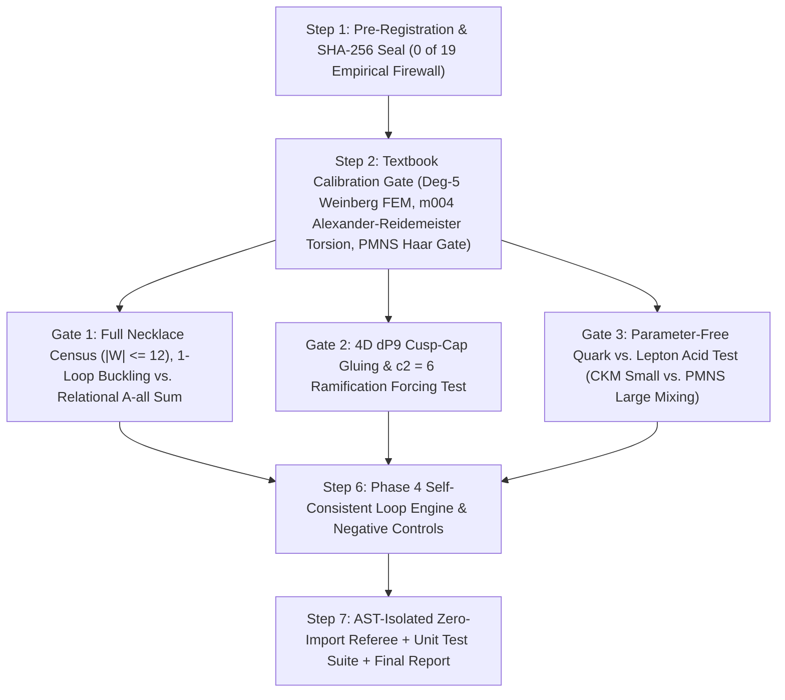

# Phase 4 Plan: 1-Loop Vacuum Selection, 4D $dP_9$ Cusp-Cap Gluing & Quark–Lepton PMNS Unification Engine

> [!IMPORTANT]
> **Clean-Room Isolation & Guardrail Covenant (`0 of 19` Empirical Inputs)**
> Phase 4 is built in `../unification_cap_lepton_phase4` with **zero modifications** to `origin-axiom`, Phase 1 (`../self_consistent_loop_phi`), Phase 2 (`../cusped_3d_loop_phase2`), or Phase 3 (`../relational_yukawa_phase3`). Every equation, calibration benchmark, falsifier, and negative control is locked in `../unification_cap_lepton_phase4/PREREGISTRATION_PHASE4.md` and sealed in `../unification_cap_lepton_phase4/SEAL_SHA256.txt` before solver code is written, strictly enforcing all 6 Mathematical-Physics Guardrails.

---

## 1. Phase 4 Architecture

---

## 2. Mathematical Specifications & Falsifiable Gates

### Step 1 — Pre-Registration & Seal (`../unification_cap_lepton_phase4/PREREGISTRATION_PHASE4.md` + `../unification_cap_lepton_phase4/SEAL_SHA256.txt`)
- Write all definitions, group-theoretic identities, calibration tolerances (`< 1e-12`), falsification criteria, and planted negative controls into `../unification_cap_lepton_phase4/PREREGISTRATION_PHASE4.md` and record its SHA-256 digest in `../unification_cap_lepton_phase4/SEAL_SHA256.txt` prior to implementing `../unification_cap_lepton_phase4/src/phase4_loop/`.

### Step 2 — Textbook Calibration Gate (`../unification_cap_lepton_phase4/src/phase4_loop/calibration_gate.py`)
Before evaluating candidate histories, verify to `< 1e-12`:
1. **Degree-4 Weinberg & Degree-3 Yukawa Simplex Quadrature:** Verify positive-weight $S_4$-symmetric 14-point degree-5 tetrahedral quadrature on all 3-simplex monomials up to degree $5$ (`< 1e-15`, covering both cubic Dirac Yukawa and quartic Weinberg $(L_L H_u)^2$ P1 integrals) and `m004` (`b++LR`, `b+-LR`) Epstein–Penner volume (`< 1e-12`).
2. **Exact Textbook Alexander–Reidemeister Torsion Benchmark on `m004` (`b++LR`) and `m003` (`b+-LR`):** Verify our twisted Fox/cellular 1-loop Reidemeister determinant $\tau_{\text{Reid}}(M, \rho_\theta)$ against the analytical figure-eight knot and sister Alexander polynomials $|\Delta(e^{i\theta})| = |3 \mp 2\cos\theta|$ at $\theta = 2\pi q / 5$ ($q = 1, 2$, to `< 1e-13`).
3. **PMNS Seesaw & Weinberg Haar Basis-Scrambling Calibration (Guardrail 3):** Verify on an analytical complex benchmark (and a real CP-conserving control) that under **independent** random Haar unitary transformations $(U_L, U_{e^c}, U_N) \in U(3)^3$, the seesaw matrix $M_\nu = -Y_\nu M_R^{-1} Y_\nu^T$, singular-value ratios, $|U_{\text{PMNS}}|$, standard PDG-convention mixing angles $(\sin^2\theta_{12}^\ell, \sin^2\theta_{23}^\ell, \sin^2\theta_{13}^\ell)$, and leptonic Jarlskog invariant $\hat{\mathcal{J}}_{\text{PMNS}}$ are invariant to `< 1e-12`.

---

### Step 3 — Gate 1: Exhaustive Necklace Census (`|W| <= 12`), 1-Loop Buckling vs. `A-all` Ensemble (`../unification_cap_lepton_phase4/src/phase4_loop/gate1_vacuum_selection.py`)
Resolves the `(6)` vs. `[5, 1, 2, 2]` selection tug-of-war with zero rigged weights:
1. **Unrestricted Necklace Census ($2 \le |W| \le 12$):** Exhaustively enumerate all cyclic words $W \in \{L, R\}^*$ up to length `12` that are hyperbolic, primitive, and preserve the Golden $\mathbb{Z}/5\mathbb{Z}$ eigenvector line $v_5 = (1, 2)^T$. Group into relational quotient classes $[M] \in \mathcal{M}_{\le 12} / \mathrm{Isom}_{\pm}$ and classify each into `amphicheiral`, `chiral_reversible`, or `chiral_irreversible`, determining the global minimal-volume chiral irreversible manifold across all $|W| \le 12$.
2. **Test 1A — `A-one` Classical Volume vs. 1-Loop Quantum Buckling:** Across `k = 0` (cusp-unramified) vs. `k != 0` (cusp-ramified) bundles on minimal reversible and minimal chiral irreversible classes, compute classical hyperbolic volume $\operatorname{Vol}(M_W)$, exact 1-loop Fox–Wada Reidemeister torsion $-\ln \tau_{\text{Reid}}(M_W, \rho_q)$, UV-subtracted twisted 3D Casimir energy, and dimensionless 1-loop Coleman–Weinberg Yukawa quartic trace.
3. **Test 1B — Relational `A-all` Partition Sum over $\mathcal{M}_{\le 12} / \mathrm{Isom}_{\pm}$:** Weight all quotient classes by $w_{[M]} \propto e^{-\operatorname{Vol}(M)}$ (and symmetry-weighted $w_{[M]}^{\text{sym}} \propto |\mathrm{Sym}^+(M)|^{-1} e^{-\operatorname{Vol}(M)}$) to compute ensemble-averaged relational moduli, CKM mixing, unbroken 4-line cancellation, and spontaneous ground-state branch relational Jarlskog $\langle \hat{\mathcal{J}}_{\text{rel}} \rangle$.

---

### Step 4 — Gate 2: 4D $dP_9$ Cusp-Cap Gluing & Ramification Forcing Test (`../unification_cap_lepton_phase4/src/phase4_loop/gate2_dp9_cusp_cap.py`)
Tests whether plugging the 3D torus cusp into a 4D rational elliptic cap ($dP_9 = \frac{1}{2}K3$) locks $N_{\text{gen}} = 3$ and cusp ramification (`k != 0`) together:
1. **Explicit $dP_9$ Lattice & Bianchi Construction:** Build the unimodular intersection lattice $H_2(dP_9; \mathbb{Z}) \cong \mathbf{I}_{1,9}$ containing the fiber class $F$ ($F^2 = 0$), base section $\Sigma_0$ ($\Sigma_0^2 = -1, \Sigma_0 \cdot F = 1$), and Mordell–Weil $E_8(-1)$ root lattice orthogonal to $(F, \Sigma_0)$, verifying $\chi(dP_9) = c_2(T_{dP_9}) = 12$ and symmetric $E_8 \times E_8$ Bianchi tadpole $k_{\text{vis}} = k_{\text{hid}} = 6 = k_{\text{inst},\min}(3)$.
2. **Peripheral Holonomy & ’t Hooft / Spectral-Cover Gluing Audit:** Audit the $SU(5)/\mathbb{Z}_5$ ’t Hooft central flux congruence and Friedman–Morgan–Witten 5-sheeted spectral curve $C \in |5\Sigma_0 + 6F|$ to determine whether bulk integer $c_2(\mathcal{V}_\perp) = 6$ alone forbids $k = 0$ on a generic smooth boundary fiber or requires a branched cusp fiber / 3D Reidemeister acyclicity.

---

### Step 5 — Gate 3: Parameter-Free Quark-vs.-Lepton Acid Test (`../unification_cap_lepton_phase4/src/phase4_loop/gate3_quark_lepton_unification.py`)
Tests whether the exact same 3D hyperbolic geometry produces small CKM quark mixing and large PMNS lepton mixing with `0 of 19` empirical inputs:
1. **Unique $\mathbb{Z}/5\mathbb{Z}$ Gauge-Invariant $E_8$ Lepton Couplings:** Verify $Y_e = Y_d^T$ and $q(N^c) = 0$ under $E_8 \supset \mathfrak{su}(5)_{\text{GUT}} \oplus \mathfrak{su}(5)_\perp$.
2. **Dual Seesaw & Weinberg Neutrino Evaluation ($N_{\text{sub}} \in \{3, 4, 5\}$):** Evaluate both 3D KK singlet seesaw ($N_1$) and exact degree-4 contact Weinberg ($N_2$) mechanisms across controls, reversible geometries, and chiral irreversible candidates, asserting `< 1e-12` Haar $U(3)^3$ invariance and `< 1e-12` enantiomer relational collapse.

---

### Steps 6 & 7 — Composite Engine, AST-Isolated Zero-Import Referee & Report
- **Step 6 (`../unification_cap_lepton_phase4/src/phase4_loop/phase4_engine.py`):** Verify SHA-256 seals of Phases 1–4, run Calibration + Gates 1–3, and write `../unification_cap_lepton_phase4/outputs/phase4_results.json`.
- **Step 7 (`../unification_cap_lepton_phase4/scripts/referee_phase4.py` + `../unification_cap_lepton_phase4/tests/test_phase4.py`):** AST-verified zero-import referee using 55-digit `mpmath` Fox–Wada determinants, Weyl-reflection $E_8(-1)$ root enumeration, Keast's 11-point degree-4 simplex quadrature, and 25 fresh adversarial Haar $U(3)^3$ trials, writing `../unification_cap_lepton_phase4/outputs/referee_phase4_verdict.json`.

---

## 3. Execution Checklist

- [x] **Step 1:** Pre-register `../unification_cap_lepton_phase4/PREREGISTRATION_PHASE4.md` and lock `../unification_cap_lepton_phase4/SEAL_SHA256.txt` (`7cc9965761c0497533147382e3f8ace80dd9582d1296f03abe64a09331a0b4f6`).
- [x] **Step 2:** Implement & pass `../unification_cap_lepton_phase4/src/phase4_loop/calibration_gate.py` (`< 1e-12`).
- [x] **Step 3:** Implement & pass `../unification_cap_lepton_phase4/src/phase4_loop/gate1_vacuum_selection.py` (`|W| <= 12` census, 1-loop buckling vs. `A-all`).
- [x] **Step 4:** Implement & pass `../unification_cap_lepton_phase4/src/phase4_loop/gate2_dp9_cusp_cap.py` (4D $dP_9$ lattice & mod-5 cusp-ramification test).
- [x] **Step 5:** Implement & pass `../unification_cap_lepton_phase4/src/phase4_loop/gate3_quark_lepton_unification.py` (CKM vs. PMNS seesaw + Weinberg acid test).
- [x] **Step 6:** Implement & pass `../unification_cap_lepton_phase4/src/phase4_loop/phase4_engine.py` (`../unification_cap_lepton_phase4/outputs/phase4_results.json`).
- [x] **Step 7:** Implement & pass AST-isolated `../unification_cap_lepton_phase4/scripts/referee_phase4.py` + `../unification_cap_lepton_phase4/tests/test_phase4.py` (`exit 0`) and deliver `phase4_unification_cap_lepton_report.md`.
